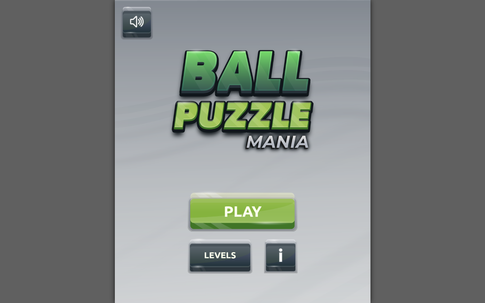
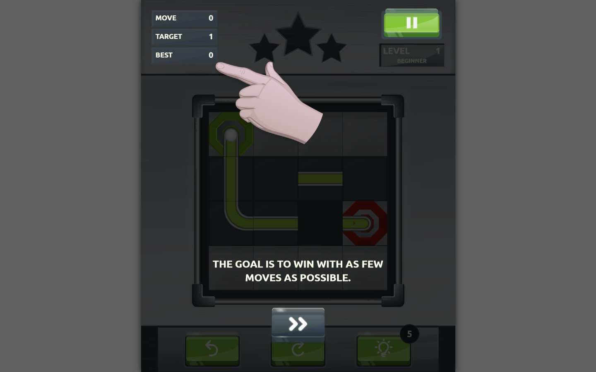
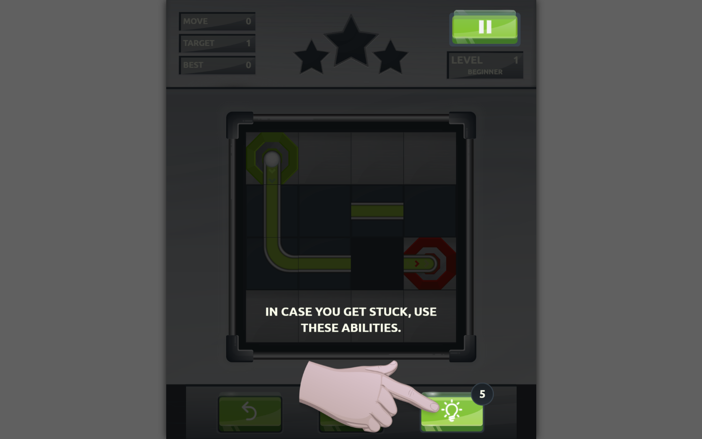
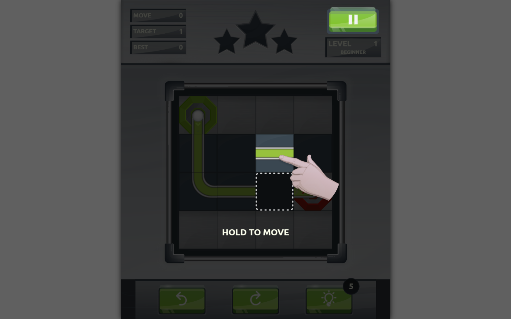
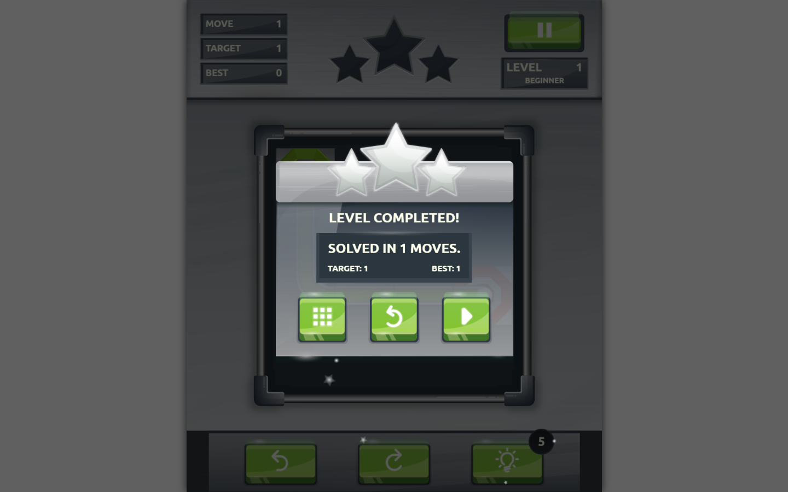

# Ball Puzzle Mania / 轨道拼球 游戏规格说明书

格式版本：V5.1

仅记录有依据的实现层事实；内容字段非必填，未知留空，不代表不存在或已经验证。

## 1. 基础事实

**维度定义**：让读者第一眼知道“这是什么类型、什么操控体验的游戏”，以及它的技术栈。

**内容说明**

Ball Puzzle Mania / 轨道拼球；MSN原生9pb96t7jntff、Inlogic公开v16。原内部Ball Puzzle1.0.0，构建2022-04-01。JavaScript/HTML、Phaser2.15.1，2D；本轮逻辑画布1080×1280、1440×900视口原缩放。

## 2. 资源类型

**维度定义**：游戏中游戏内容元素的资源类型是什么——即在哪个引擎运行下的资源格式。

**内容说明**

42原上游静态文件，40运行文件、38原字节保持；仅入口与js/game.js服务边界修改，原SDK脚本/跨域迁移脚本/PWA入口退役。原88帧图集2607×2581、原PNG/Ubuntu-B.ttf、11条声音声明的10种声音双格式及音乐双格式、lang.xml、240关与240提示文本齐备。Levels.json/Hints.json实际为原自定义逐行数字文本，不能按扩展名冒称JSON对象。

## 3. 核心挑战维度

**维度定义**：游戏核心玩法主要挑战 / 满足人的什么。

**内容说明**

在方形棋盘中移动可滑动的直线/转弯轨道块，借空位连接固定起点与终点，使原小球沿连续轨道到达终点；用尽量少的移动获得更好星级。与拉动软管端点接水的已有两款区别为离散空位滑块和轨道连接判定。

## 4. 操控方式

**维度定义**：操控本身的复杂度 + 需要玩家判断的时机 / 策略复杂度。

**内容说明**

原鼠标/触摸按住轨道块，水平或垂直拖至相邻空位；固定块不可移动。PLAY、LEVELS、暂停、重置、撤销、提示与说明入口保留。本轮只菜单/教程/提示/一条实际拖动，没有直接执行业务方法。

## 5. 行为路径

**维度定义**：玩家一局里重复做什么。

**内容说明**

累计5次真实玩家输入：首载→原PLAY→原教程继续→原提示按钮→按画面高亮将直轨块从第2行第3列向下拖到空位。第5步原截图显示LEVEL COMPLETED、SOLVED IN1MOVES、TARGET1、BEST1；实际鼠标down/move/up轨迹与原截图已取回并打开检查。没有第6次输入、刷新、业务handler调用、关卡/分数/提示/存档/RNG/时间注入。未复验刷新、后续关卡和全部240关。

## 6. 游戏路径（关键节点 + 流失风险）

**维度定义**：从开始到结束的流程 + 每个关键节点的潜在流失风险点。

**内容说明**

加载原菜单→PLAY默认首关→原移动次数说明→原提示能力说明→高亮一块并显示HOLD TO MOVE→普通向下拖动→原一移动通关弹窗及继续/重玩/关卡按钮。5张真实截图已打开检查。

## 7. 成长路径

**维度定义**：玩家如何推进变强。

**内容说明**

原60关一组×4难度共240条关卡与对应240条提示数据；原levelProgress、星级、最佳移动次数、提示数、音乐偏好通过rtb-data本地存储。实际首关通关及BEST1画面已证明；保存代码保持，但本轮没有刷新验证存档恢复或第二关解锁。

## 8. 核心闭环（目标-规则-反馈-激励）

**维度定义**：游戏是否具备“明确目标 → 明确规则 → 达成反馈 → 奖励激励 → 下一目标”的完整闭环。

**内容说明**

原按下记录块坐标/合法空位→逐帧根据真实指针移动→释放后原移动计数/历史记录→沿轨道连接检查→原小球移动→原星级/最佳移动/关卡完成弹窗。首关真实一移动闭环；无为了通过而预设路径或结果。

## 9. 玩法规则

**维度定义**：核心循环、玩法规则、目标与进度。

**内容说明**

261原生方法中253个规范AST完全相同；7处仅去掉非奖励广告触发，GamePlay.startNewGame仅移出普通开始体，原教程保留。原Levels解码、GameElements拼块、GamePlay移动/路径/撤销/提示/星级、Pajko小球动画和本地存档原方法保持。Phaser/p2引擎前缀原字节保持。

## 10. 数值配置

**维度定义**：影响玩法的关键数值。

**内容说明**

4难度×60=240关；原首关4×4，目标1步，本次实际1步完成/BEST1。原初始提示5，新手提示不扣次数；本轮提示5保持。原普通关提示消耗、三档星级、重置和撤销规则代码保留，未额外操作。

## 11. 关卡配置

**维度定义**：关卡结构、递进规律、难度曲线。

**内容说明**

原Levels.json每行前8位为难度/尺寸/金银步数/开始时间，后续每格3位id/方向/可移动标记；240行长度逐项符合8+3×size²。Hints.json为原240行三位动作数据。棋盘包含空位、固定空白、起点/终点、直轨、弯轨；原4×4/5×5布局与难度解锁保持，不用关卡条数冒称全关试玩。

## 12. 系统设计

**维度定义**：功能系统清单、UI 流程。

**内容说明**

原Phaser生命周期Splash→Preload→GameState；GUI/Screen分工，GamePlay维护棋盘与移动，Levels解析原数字文本，GameElements管理块图与连接，Pajko执行球沿路径动画，MusicPlayer播放本地音频。纯同源静态运行，不依赖账号/在线玩家/服务器存档。实际MSStart、Inlogic、Adinplay广告/统计提供者、模拟广告实现、7个广告触发、SDK页脚、serviceWorker及跨域存档迁移入口物理移除。原普通非奖励开始逻辑5条语句从非奖励广告生命周期提取，紧随原新手教程调用；无SDK替身、身份/token、广告成功或奖励注入。原本地5次提示初值与新手不扣提示的规则保持。

## 13. 主题化包装

**维度定义**：游戏的题材 / 世界观包装。

**内容说明**

原灰色金属框、绿灰轨道、绿色起点/红色终点、小球、木星式通关星与绿色按钮；MOVE/TARGET/BEST、LEVEL/BEGINNER及手势教程保持。原图集与实际截图保留，未改占位图。

## 14. 养成系统 + 经济系统

**维度定义**：玩家如何成长、经济如何循环。

**内容说明**

原星级、最佳步数与提示次数为本地进度。初始5提示、首关新手提示不扣，真实1步通关；没有新增货币、自动赠送、广告奖励、支付或服务器经济。

## 15. 角色 / 单位设定

**维度定义**：有哪些角色/单位、各自定位（玩法层面）。

**内容说明**

原起点球、终点、直轨/弯轨/固定块/空格、提示轮廓与手指、通关星及原菜单按钮。本轮真实高亮直轨下移和通关画面已见；其他关卡全部对象资源齐备但未逐一操作。

## 16. 商业化

**维度定义**：靠什么变现。

**内容说明**

实际MSStart、Inlogic、Adinplay广告/统计提供者、模拟广告实现、7个广告触发、SDK页脚、serviceWorker及跨域存档迁移入口物理移除。原普通非奖励开始逻辑5条语句从非奖励广告生命周期提取，紧随原新手教程调用；无SDK替身、身份/token、广告成功或奖励注入。原本地5次提示初值与新手不扣提示的规则保持。远端52真实Chromium五步观察期间29同源请求/29响应均HTTP200，无外联、失败请求或游戏脚本异常，3条原Canvas/音频自动播放warning保留。完整运行40文件另逐项远端HTTP/SHA核对。第5步的原截图、network/console/inputs已保存，但记录器在结果JSON序列化时堆内存耗尽，实际Node退出134；完整第5步原生状态JSON缺失，未伪造补值。原图直接证明1步通关，原第1至4步JSON与全部输入轨迹保留。真实本实例Node与Chrome已全部退出；没有把134说成正常exit0，也未因此重跑游戏。共享记录器补共享引用去重与50000对象上限，5项自编数据检查通过，未用额外游戏输入验证该工具修复。

图 1：原菜单PLAY/LEVELS

图 2：原首关与移动目标教程

图 3：原能力按钮教程

图 4：原提示高亮拼块与目标空位

图 5：真实下拖后原LEVEL COMPLETED，SOLVED IN1MOVES、TARGET1、BEST1
