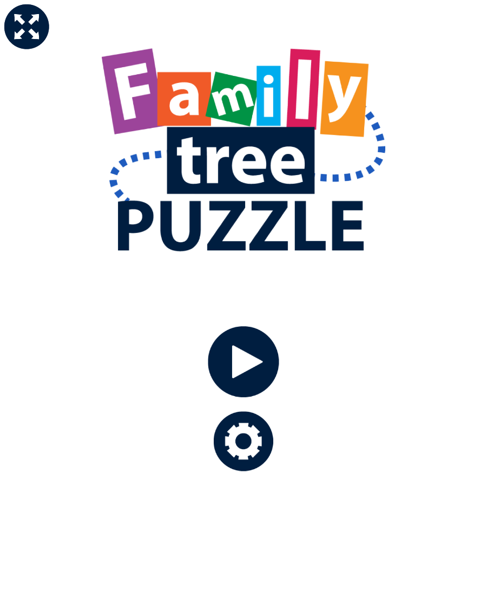
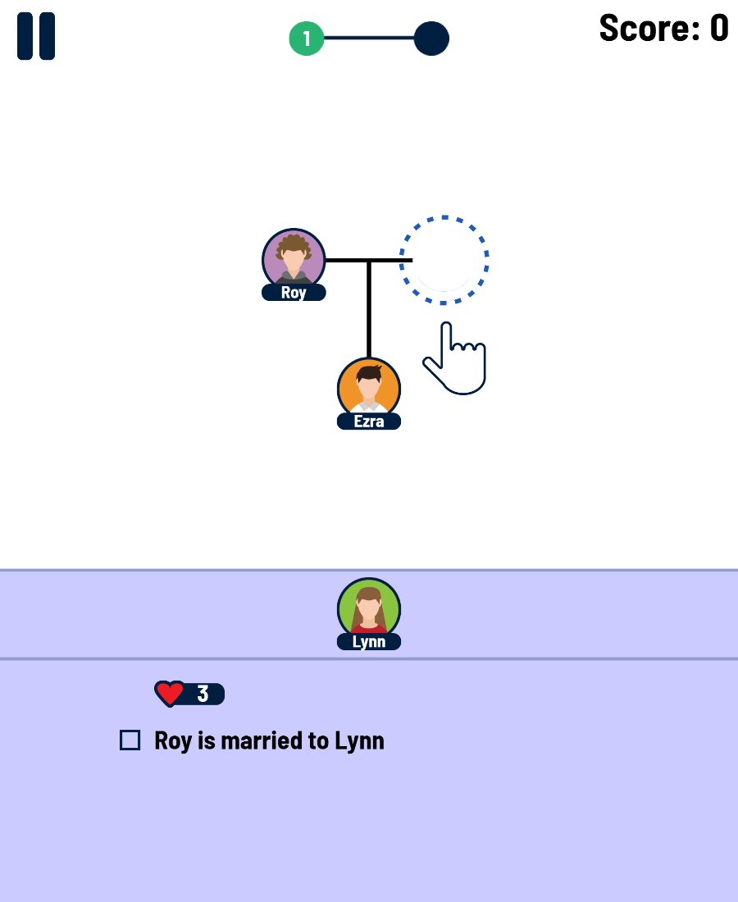
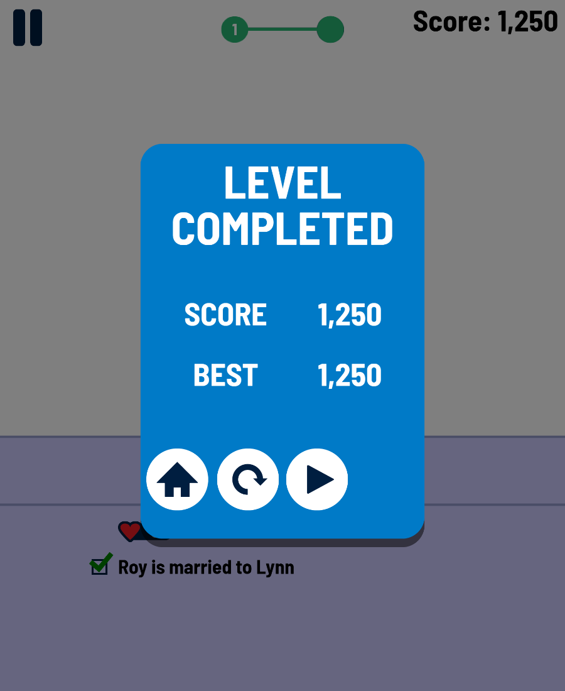
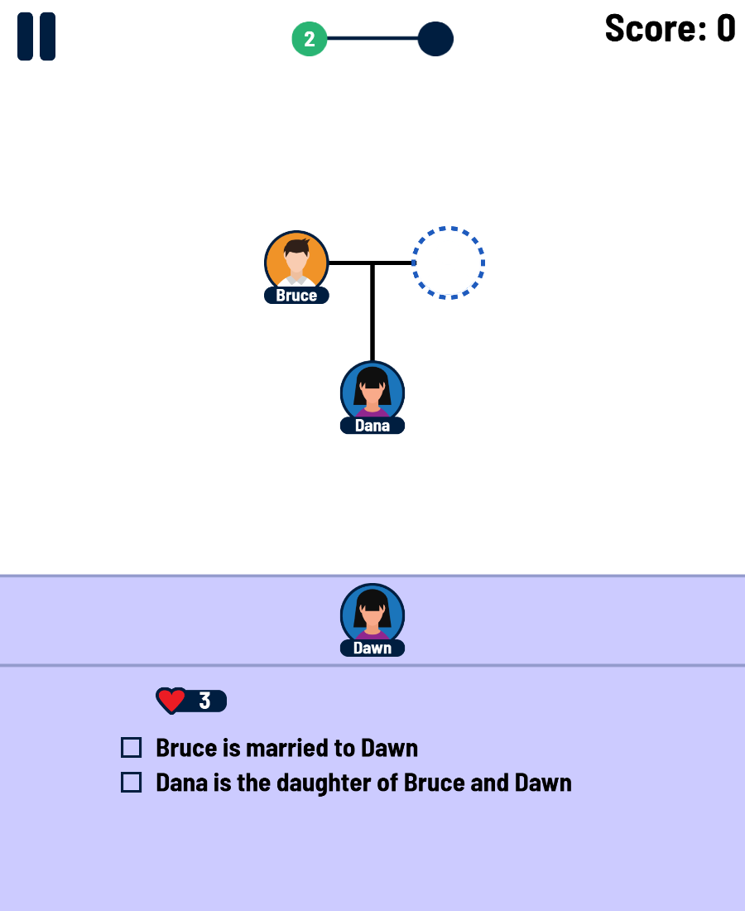

# Family Tree Puzzle 游戏规格说明书

格式版本：V5.1

仅记录有依据的实现层事实；内容字段非必填，未知留空，不代表不存在或已经验证。

## 1. 基础事实

**维度定义**：让读者第一眼知道“这是什么类型、什么操控体验的游戏”，以及它的技术栈。

**内容说明**

Family Tree Puzzle，MSN身份9p4vbq3rq8gz，MarketJS公开v3，ImpactJS/Canvas2D与原音频库，JavaScript/HTML/CSS，2D亲属关系逻辑拼图。交付family-offline-v2，原生玩法实测在v1；v2只修本包Worker策略。

## 2. 资源类型

**维度定义**：游戏中游戏内容元素的资源类型是什么——即在哪个引擎运行下的资源格式。

**内容说明**

原人物头像/姓名牌、家谱节点、提示手势、生命/勾选、关卡/结算UI、背景、MP3/OGG音效和音乐、原BarlowSemiCondensed Bold字体（游戏内名grilledcheese）与品牌图。74原依赖/素材文件SHA不变，76基础文件。原新增2个branding图来自明确源码路径。

## 3. 核心挑战维度

**维度定义**：游戏核心玩法主要挑战 / 满足人的什么。

**内容说明**

阅读亲属文字线索，将待放置的具名人物拖到家谱空槽，依据父母/配偶/子女关系推断位置。首关实测可见Roy is married to Lynn，正常将Lynn放到配偶位置。未读取运行时隐藏答案来指导输入。

## 4. 操控方式

**维度定义**：操控本身的复杂度 + 需要玩家判断的时机 / 策略复杂度。

**内容说明**

原鼠标/触控拖拽、Play、关卡、Next、暂停/回家/重玩/声音/全屏。实际鼠标一次拖拽，完整记录move/down/12段move/up共15条底层子事件；五个检查点不等于五次底层鼠标事件。触屏偏移、设置等只源码保留，未测。

## 5. 行为路径

**维度定义**：玩家一局里重复做什么。

**内容说明**

原自动开场至菜单→Play→关卡1→原首次教学手势与文字线索→拖Lynn至配偶槽→原勾选/1250分/LEVEL COMPLETED→Next→原第2关Bruce/Dawn/Dana关系图和两条线索。

## 6. 游戏路径（关键节点 + 流失风险）

**维度定义**：从开始到结束的流程 + 每个关键节点的潜在流失风险点。

**内容说明**

原菜单、关卡分页、教学、家谱、结算和下一关可见；首关之外尚未试玩。原广告提示、分享、更多游戏入口已物理删除，不显示按钮等待假回调。原品牌归属图保留，外部跳转覆盖层退役。

## 7. 成长路径

**维度定义**：玩家如何推进变强。

**内容说明**

源码120个level配置、人物名/头像池AST完全一致；关卡页12关/页共10页。首关实际完成并解锁2，Next实际进入第2关。未把配置数当已通过关数，未解锁或跳过其余关。

## 8. 核心闭环（目标-规则-反馈-激励）

**维度定义**：游戏是否具备“明确目标 → 明确规则 → 达成反馈 → 奖励激励 → 下一目标”的完整闭环。

**内容说明**

读线索→选择具名人物→原拖拽/悬停/释放→原关系判定与勾选、分数/生命反馈→补齐家谱→原结算/解锁→下一关。首关此闭环完整实测，第二关只进入，未完成。

## 9. 玩法规则

**维度定义**：核心循环、玩法规则、目标与进度。

**内容说明**

原EntityFamilyTree/Node/Character、关系图/姓名分配/随机、拖拽判定、错误扣命、原教学与计分保持。221原生实体/主类方法中190个AST不变，12个为已退役服务按钮方法，19个是列出的广告/报分/分享/外链/中心调用删除。原getAdHint仍供首次教学内部使用，无广告按钮或奖励回调代替。

## 10. 数值配置

**维度定义**：影响玩法的关键数值。

**内容说明**

源码：120关、每页12关；首关3个节点、2已定义/1待填，3生命；原正确放置100、过关1000、每剩余生命50。实测首关100+1000+3×50=1250，best1=1250、session level2；第2关开始score0/life3，未测扣命。

## 11. 关卡配置

**维度定义**：关卡结构、递进规律、难度曲线。

**内容说明**

原120关members的ID/gender/parents/partners/children/defined、life与hints数据AST相同，人物名/头像池也完全相同。由本地关系配置生成图与文字，未使用每日服务或远端关卡表，未强制循环首关。

## 12. 系统设计

**维度定义**：功能系统清单、UI 流程。

**内容说明**

保留原Impact场景/Pointer/IO、家谱节点/人物、关系判定、计分/生命/关卡/原localStorage、字体与音频。移除Microsoft Start/CPMStar/GA提供模块和API实例、广告调用/提示回调、在线报分、分享与更多游戏按钮/场景描述、外链覆盖层；原CDN迁移fetchData与广告DOM不进入新入口。原JJ只有限字面量解码，警告声明保留且不执行动态源码。

## 13. 主题化包装

**维度定义**：游戏的题材 / 世界观包装。

**内容说明**

原白底、深蓝按钮和关系线、彩色人物头像、浅紫线索托盘、蓝色结算/关卡弹窗、绿色正确勾与原提示手势。保留原画与字体，未使用生成占位图。

## 14. 养成系统 + 经济系统

**维度定义**：玩家如何成长、经济如何循环。

**内容说明**

原本地sessionData和localStorage保留声音/音乐/解锁关/各关最佳分/首次教程标记。实际首关后best1=1250、level2，Next继续可见；未刷新，不称已验证跨刷新保存。没有新增货币、购买或免费广告权益。

## 15. 角色 / 单位设定

**维度定义**：有哪些角色/单位、各自定位（玩法层面）。

**内容说明**

家谱人物为原本地姓名/性别/头像池的虚构角色，非在线账号或玩家。实际首关Roy/Ezra/Lynn；第2关Bruce/Dana/Dawn。父母/配偶/子女结构来自原关卡，不伪造用户身份。

## 16. 商业化

**维度定义**：靠什么变现。

**内容说明**

原广告提示按钮及reward回调删除，不自动发提示；首次教学的原有提示保留。间屏、分享、在线累计报分、外部推广/服务端迁移调用均退役。独立静态HTTP启动，不连接业务服务端。原v1游戏全量60请求/60响应全部本地HTTP200，无请求失败、外联或pageerror异常。保留1条AudioContext自动播放警告及1条本包Meta CSP阻止原彩纸Blob Worker的控制台错误。最终v2只有index.html增加worker-src self blob；其余75基础文件、游戏脚本和素材逐字节相同。独立中性页面无游戏/SDK，真实验证同一旧策略阻止、新策略创建Worker并收到local-worker-ok；旧中性页另有默认favicon404，原始日志保留。没有追加最终v2整款游戏试玩，不把独立策略验证称为彩纸实显复验或零历史错误。

图 1：原菜单与品牌字样

图 2：原首关Roy/Lynn配偶线索、教学和3生命

图 3：普通拖拽后原首关1250分完成；历史Worker策略错误保留

图 4：原Next进入第2关，新的名字和父母/配偶线索
