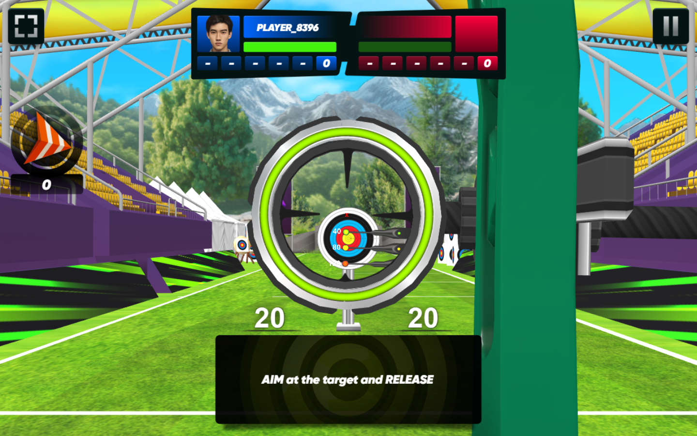
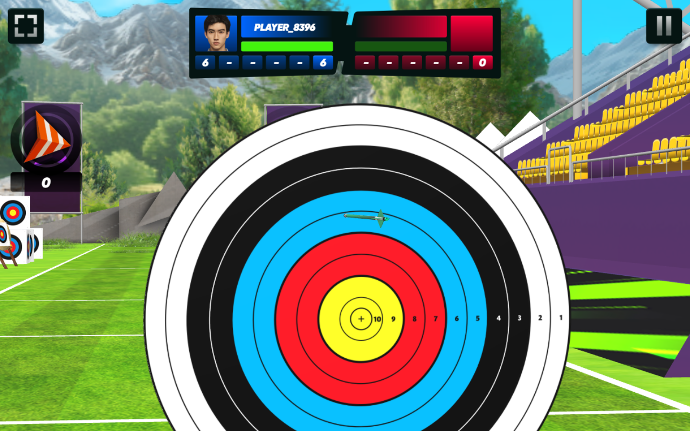
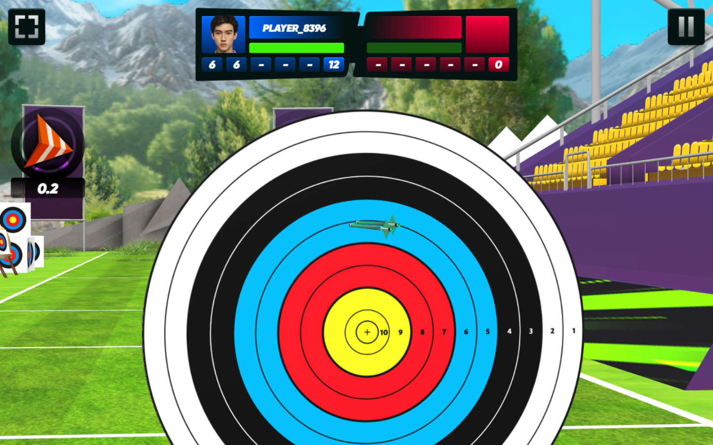

# Archery Master / 射箭大师 游戏规格说明书

格式版本：V5.1

仅记录有依据的实现层事实；内容字段非必填，未知留空，不代表不存在或已经验证。

## 1. 基础事实

**维度定义**：让读者第一眼知道“这是什么类型、什么操控体验的游戏”，以及它的技术栈。

**内容说明**

Archery Master / 射箭大师，MSN原生9nwr5gkn2zcp，公开Inlogic构建v13。实际标题1st Archery Master，原控制台标识Inlogic Games2025/Archery Master v0.1。Babylon.js原生JavaScript单机3D射箭；保留原本地AI对手，没有构造服务器对手协议。

## 2. 资源类型

**维度定义**：游戏中游戏内容元素的资源类型是什么——即在哪个引擎运行下的资源格式。

**内容说明**

97项运行文件。原Babylon引擎及游戏脚本、14个GLB模型、10组PNG/JSON图集、弓/靶/箭/场馆纹理与音频、OTF/TTF字体、XML语言数据和启动图。92项声明原资源逐SHA核对，14模型内部图像/缓冲无外部URI，10组图集图片闭包通过；没有重画替代核心素材。

## 3. 核心挑战维度

**维度定义**：游戏核心玩法主要挑战 / 满足人的什么。

**内容说明**

按住拉弓、移动瞄准并松开发箭，在原靶面环分、距离、风力和靶运动规则下取得分数；普通模式原5箭与本地AI比较，推进场馆、奖杯和弓成长。实际第一箭6分、第二箭6分，累计12分；没有实测普通模式胜负。

## 4. 操控方式

**维度定义**：操控本身的复杂度 + 需要玩家判断的时机 / 策略复杂度。

**内容说明**

原鼠标或触屏连续按住、移动、释放；实机只用普通鼠标。第3步从(720,600)连续拖至(720,450)，第4步从(720,600)至(720,480)，每次移动后保持2500ms再释放，都是一个持续真实手势。第1载入、第2点击继续、第5刷新。未调用射箭/命中/存档函数或改状态、随机、时钟。

## 5. 行为路径

**维度定义**：玩家一局里重复做什么。

**内容说明**

累计5步：载入原启动页；普通点击TAP TO CONTINUE进入原首局教程；一次连续按住/拖动/松开拉弓射箭，原命中6分；第二次独立连续手势再命中6分，累计12分、风力显示0.2；普通刷新返回原启动页。两次拉弓保持截图和5张步骤图全部已打开检查，共7张。

## 6. 游戏路径（关键节点 + 流失风险）

**维度定义**：从开始到结束的流程 + 每个关键节点的潜在流失风险点。

**内容说明**

启动图/原资源加载→TAP TO CONTINUE→原首局射箭教程；教程完成后进入原主菜单→原本地对手匹配动画→5箭对局→原胜负/奖杯/收益→场馆与普通弓升级/商店→再对局。首次路径由原OnboardingStep判断，本轮没有跳过教程或进入普通对局。

## 7. 成长路径

**维度定义**：玩家如何推进变强。

**内容说明**

原本地教程阶段、场馆奖杯、金币、弓参数/升级与箱子保存逻辑保留。原对手AI及原姓名/头像动画属于原本地流程，不是SDK登录成功。实际教程内部0→1→5→6，刷新回0；尚未完成教程，未验证长期进度恢复。

## 8. 核心闭环（目标-规则-反馈-激励）

**维度定义**：游戏是否具备“明确目标 → 明确规则 → 达成反馈 → 奖励激励 → 下一目标”的完整闭环。

**内容说明**

目标为原靶面得分并在普通模式以5箭总分挑战本地AI；按住充弓、拖动控制原瞄准、松开创建原箭矢，按原箭物理和靶环碰撞计分；反馈为瞄准镜缩放、箭飞行/命中镜头、原箭插靶和顶部6/6/12数字。下一轮/升级与胜负仅源码确认。

## 9. 玩法规则

**维度定义**：核心循环、玩法规则、目标与进度。

**内容说明**

原ScreenGame指针与aim、箭矢速度/重量/风偏/目标碰撞、环分、每轮5箭和本地OpponentAI判定保留。未改变瞄准门槛、命中半径、伤害、距离或难度；两次实际原箭snapped=true/miss=false，均由普通手势触发。

## 10. 数值配置

**维度定义**：影响玩法的关键数值。

**内容说明**

实际靶距显示20；第一箭6分、第二箭6分、累计12分；第二箭前风力显示0.2。原普通模式5箭、靶面可见10至1环值。本款97运行文件/14GLB/10图集。升级价格、场馆总数与全部曲线本轮不填写无实测数值。

## 11. 关卡配置

**维度定义**：关卡结构、递进规律、难度曲线。

**内容说明**

原Stadiums场馆/距离/移动靶配置、场地模型、弓参数和Onboarding教程保持。14个模型不是14关，图集数也不是关卡数。仅首局静态靶两箭、20距离有实玩证据，全部场馆、距离、风和靶运动组合未穷尽。

## 12. 系统设计

**维度定义**：功能系统清单、UI 流程。

**内容说明**

退役真实Inlogic广告/统计/身份、Adinplay、MSStart、原假广告测试类与PWA服务工作者；删除广告专属商店领币方法和广告倍增按钮绑定。普通开局继续逻辑直接使用原回调内原生表达式；结算选择原作者无广告基础奖励分支，不合成广告成功、SDK身份或奖励。原352个原生prototype方法保留351个，341个AST一致，10个方法改动限广告消费；删除的唯一方法是广告商店onClaimClick。83个受保护射箭/加载/声音方法及原OpponentAI的14段赋值AST完全一致。 原资源加载、Babylon场景/GUI、相机切换、拉弓瞄准、箭矢/靶判定、原本地AI、教程、奖杯/场馆、普通经济与本地存档系统保留。实际191请求/191同源200，0外联、0失败、0警告、0脚本错误，未截断网络/控制台；并非只靠CSP挡请求而声称离线。

## 13. 主题化包装

**维度定义**：游戏的题材 / 世界观包装。

**内容说明**

原鲜亮写实卡通体育射箭场、看台/雪山/草地、绿色弓、彩色靶环、第一人称瞄准镜、分数条/头像和引导文字。两箭命中及拉弓画面均已查看；没有替换原美术/模型或重建简化演示。

## 14. 养成系统 + 经济系统

**维度定义**：玩家如何成长、经济如何循环。

**内容说明**

原普通金币/奖杯收益、场馆和弓成长、按原价购买/开箱保留；广告赠币/倍增入口退役，不给免费替代奖励。原结算无广告分支原样选取；本轮没有结算或购买，不能把源码存在写成已经到账或支付。

## 15. 角色 / 单位设定

**维度定义**：有哪些角色/单位、各自定位（玩法层面）。

**内容说明**

实际原第一人称弓、两支箭、靶面、玩家头像/本地昵称、场馆对象可见。原多弓与AI难度/头像/名字配置保留；教程中对手栏隐藏，未声称已匹配真实玩家或实际完成AI对局。

## 16. 商业化

**维度定义**：靠什么变现。

**内容说明**

退役真实Inlogic广告/统计/身份、Adinplay、MSStart、原假广告测试类与PWA服务工作者；删除广告专属商店领币方法和广告倍增按钮绑定。普通开局继续逻辑直接使用原回调内原生表达式；结算选择原作者无广告基础奖励分支，不合成广告成功、SDK身份或奖励。原352个原生prototype方法保留351个，341个AST一致，10个方法改动限广告消费；删除的唯一方法是广告商店onClaimClick。83个受保护射箭/加载/声音方法及原OpponentAI的14段赋值AST完全一致。 原本地经济不变，没有登录、在线排行榜、外部支付/充值或广告请求。实际只验证首局教程中的拉弓、瞄准、箭矢飞行、两次命中计分和刷新加载。没有射完5箭或完成教程，没有实玩普通AI对局、胜负结算、奖杯/基础收益、商店、弓升级、开箱和全部场馆/距离/移动靶。刷新时原教程未完成，原OnboardingStep回0，不能声称已保存完成进度。没有听音或触屏/移动端验证。

图 1：第一次原生拉弓/瞄准保持

图 2：原第一箭6分

图 3：原第二箭6分，累计12分
