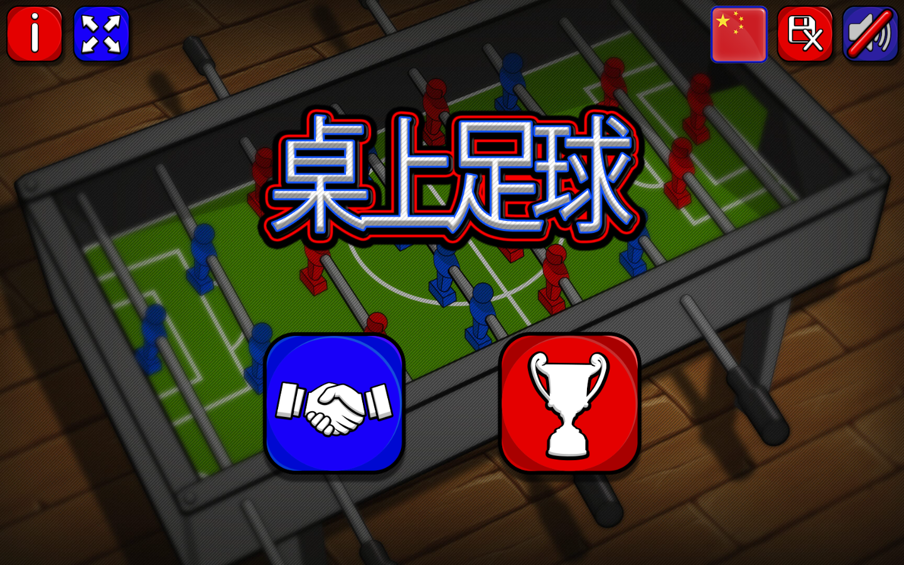
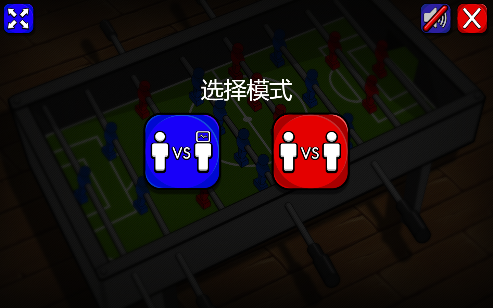
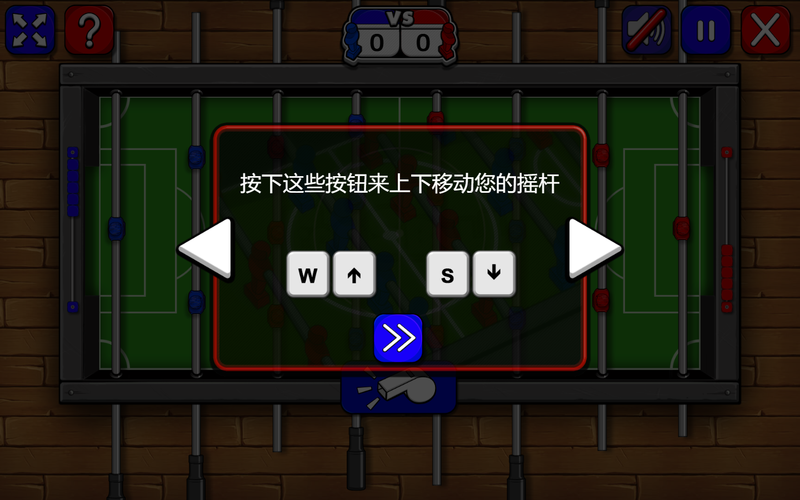
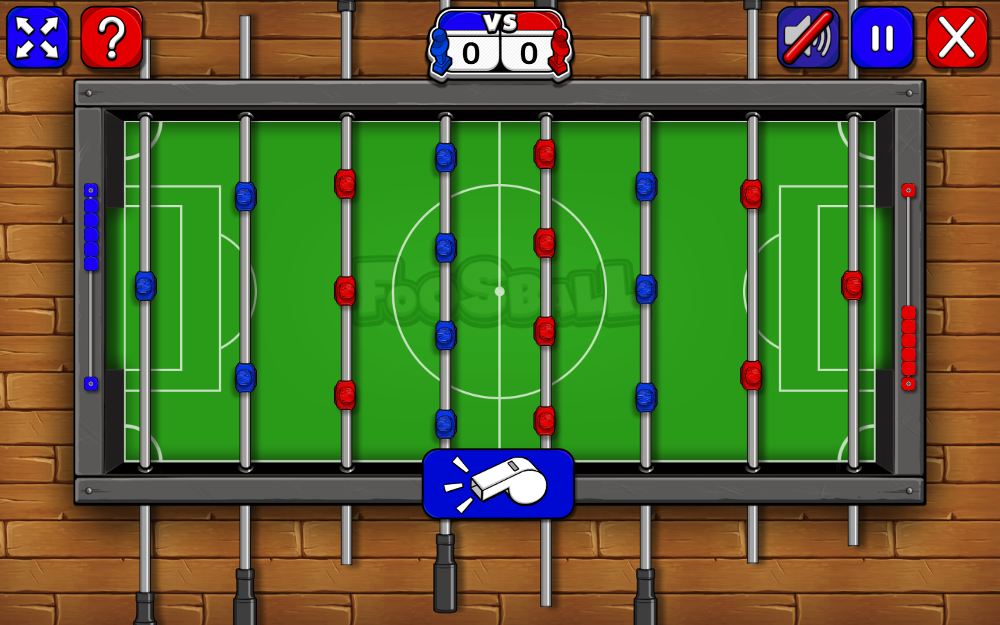
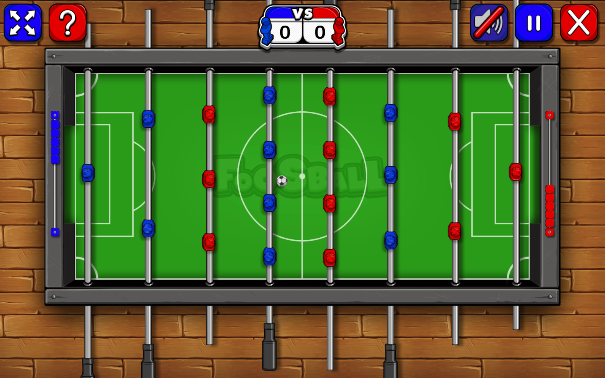

# Foosball / 桌上足球 游戏规格说明书

格式版本：V5.1

仅记录有依据的实现层事实；内容字段非必填，未知留空，不代表不存在或已经验证。

## 1. 基础事实

**维度定义**：让读者第一眼知道“这是什么类型、什么操控体验的游戏”，以及它的技术栈。

**内容说明**

Foosball（原中文标题“桌上足球”），MSN原生9pncqrbdtqn2，CodeThisLab公开v5构建。原CreateJS/EaselJS/TweenJS、Howler，JavaScript/HTML/CSS，逻辑1920×1080；实际远端52 Chromium视口1440×900，开发环境仅静态审阅和打包。

## 2. 资源类型

**维度定义**：游戏中游戏内容元素的资源类型是什么——即在哪个引擎运行下的资源格式。

**内容说明**

96份上游原文件，另有本地采集元数据；去除安装清单后95份运行文件，92份原文件字节保持，入口/主脚本/未用SoundJS模块作限定退役。原球场、桌框/摇杆、红蓝球员、足球/阴影、比分/计分珠、13语标题及进球图、按钮/教程、10份原MP3和RoundedMplus1c字体保持。

## 3. 核心挑战维度

**维度定义**：游戏核心玩法主要挑战 / 满足人的什么。

**内容说明**

控制己方桌上足球摇杆上下移动，让原球员与足球发生物理接触，与本地电脑竞争进球；球可沿桌边反弹，先达原目标进球数的一方获胜。此次实际验证开球、球体运动、CPU跟随及CPU一方得分/回到待开球，不宣称已验证玩家操作进球。

## 4. 操控方式

**维度定义**：操控本身的复杂度 + 需要玩家判断的时机 / 策略复杂度。

**内容说明**

原鼠标点选友谊赛/人机/教程跳过/哨子开球。源码中W/S和方向键控制摇杆，空格可开球；本轮只点哨子，没有输入这些按键或修改场景字段。原本地双人和移动按钮保留但未实测。

## 5. 行为路径

**维度定义**：玩家一局里重复做什么。

**内容说明**

累计5次真实输入：精确离线入口→原友谊赛握手按钮→原人机单人按钮→原教程跳过按钮→原哨子开球。实际球体由隐藏变可见并移动/滚动，红方CPU球员随原AI上下移动。之后仅一次零输入被动截图，比分由0:0变为0:1，原球隐藏并重新出现开球按钮；这是原CPU一方进球，不称玩家手动进球。未发第6次按键/点击，未验证玩家摇杆移动、完整5球胜负、锦标赛20档、本地双人、刷新、其他语言、手机或音频听感。

## 6. 游戏路径（关键节点 + 流失风险）

**维度定义**：从开始到结束的流程 + 每个关键节点的潜在流失风险点。

**内容说明**

原菜单（友谊赛/锦标赛）→友谊赛→人机或本地双人选择→首次教学与原跳过→球场待开球→正常哨子开球→原球体/碰撞/AI更新→进球→原回中与再次待开球。完整胜局与结算界面仅源码确认，未追加试玩。

## 7. 成长路径

**维度定义**：玩家如何推进变强。

**内容说明**

锦标赛原20档配置和原关卡/分数localStorage读取保存函数保持，字段按原GAME_NAME使用；本轮仅原ls_available探测和友谊赛，不宣称锦标赛解锁、刷新存档或通关已验证。

## 8. 核心闭环（目标-规则-反馈-激励）

**维度定义**：游戏是否具备“明确目标 → 明确规则 → 达成反馈 → 奖励激励 → 下一目标”的完整闭环。

**内容说明**

等待开球→原随机初速发球→玩家/CPU摇杆与球接触、边界反射→原球门判定→比分和计分珠更新→原再次开球或整局结束。本轮实际0:0→红方1分并重现哨子，未人为设置分数或球体位置。

## 9. 玩法规则

**维度定义**：核心循环、玩法规则、目标与进度。

**内容说明**

原CGame/CStick/CBall的开球、按键、AI、边界/球员碰撞、进球判定、回中及更新逻辑保持；14个关键方法逐项一致，274个原生方法AST未变。原随机函数和20档关卡表保持，不改速度、碰撞体、难度或输赢条件。友谊赛实际HTML配置5球获胜，保留5，不按目录简介的7球改写。

## 10. 数值配置

**维度定义**：影响玩法的关键数值。

**内容说明**

原逻辑画布1920×1080，原13语言，20档锦标赛配置。友谊赛目标5球、CPU速度参数5，本轮实际BALL_SPEED参数18；锦标赛原目标从5逐渐至10，CPU速度从5至100，球速从15至30（源码值，不换算为米/秒）。实际被动观察比分0:1，不是完整一局。

## 11. 关卡配置

**维度定义**：关卡结构、递进规律、难度曲线。

**内容说明**

同一原桌面球场，锦标赛保留20档points_to_win/cpu_speed_sticks/ball_speed表，菜单原每页1行5列。20档不称20张不同地图；本轮友谊赛，没有篡改选择状态或跳过原菜单以挤入步数。

## 12. 系统设计

**维度定义**：功能系统清单、UI 流程。

**内容说明**

原SpriteLibrary图片、Howler声音、CreateJS渲染/Tween、球杆/足球/场边几何、CPU、比分/计分珠、锦标赛/存档、教程、暂停、语言与全屏。实际退役MSN/更多游戏/广告/通知接入、完成事件、排行上传、SW安装及对应调用者；使用真实navigator语言/连通状态，不伪造SDK或服务器准备。

## 13. 主题化包装

**维度定义**：游戏的题材 / 世界观包装。

**内容说明**

原木桌/绿茵俯视场景、红蓝球员与金属摇杆、顶部0:0/0:1比分、两侧计分珠，中文原图片标题、原键盘教程和蓝色哨子。五张输入截图及一张零输入进球截图均已打开检查；2D Canvas以原素材表现桌面层次，不称真正3D场景引擎。

## 14. 养成系统 + 经济系统

**维度定义**：玩家如何成长、经济如何循环。

**内容说明**

原友谊赛以进球决胜；锦标赛原胜分100×己方进球−50×对方进球及本地累计分数函数保留（源码）。无充值、真实货币交易、奖励广告或新增道具经济。此次没有领取或伪造奖励，也未验证锦标赛结算。

## 15. 角色 / 单位设定

**维度定义**：有哪些角色/单位、各自定位（玩法层面）。

**内容说明**

原红蓝两队球员/四类摇杆，门将、后卫、中场、前锋，足球、球场边界/球门、比分、计分珠、开球哨子与暂停/帮助等原控件。实际看到双方原球员、球体和红方CPU位移；玩家摇杆按键、本地双人未验证。

## 16. 商业化

**维度定义**：靠什么变现。

**内容说明**

实际广告/更多游戏/通知SDK脚本和消费者、广告完成事件、静音服务通知、分数上传和安装SW退役；原本地计分/存档及同机双人保留，原玩法不依赖后台、账号、联机匹配或真实购买。最终93请求/93响应均同源HTTP200，无外联、失败请求或脚本异常；1条启动前AudioContext限制和1条Canvas2D readback性能提示原样保留，不宣称零warning。浏览器17274实际BROWSER_EXIT0。实际游戏和SDK没有在开发环境执行。

图 1：原中文桌上足球菜单

图 2：原友谊赛人机/本地双人选择

图 3：原首次键盘教程与跳过按钮

图 4：原球场待开球，比分0:0

图 5：原开球后足球运动，CPU跟随
