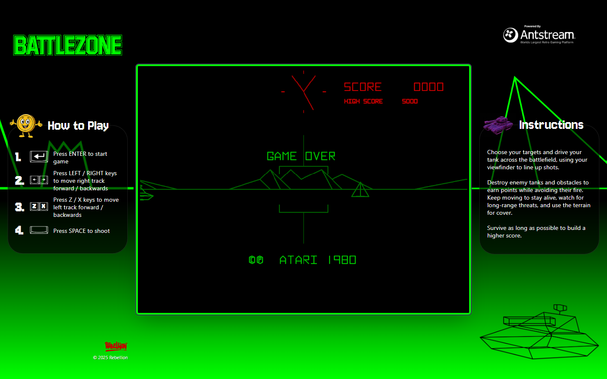
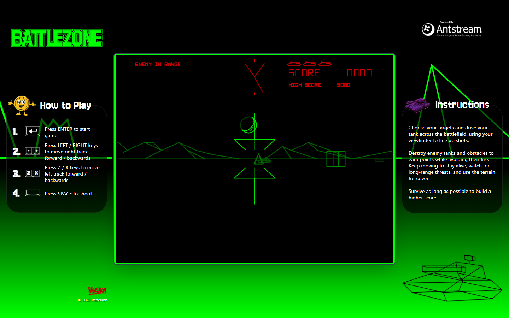
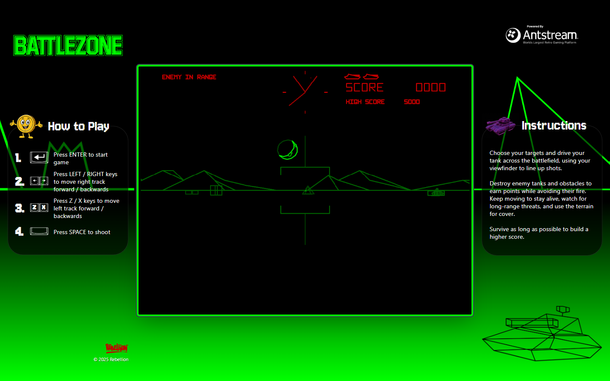

# Battlezone / 战区坦克 游戏规格说明书

格式版本：V5.1

仅记录有依据的实现层事实；内容字段非必填，未知留空，不代表不存在或已经验证。

## 1. 基础事实

**维度定义**：让读者第一眼知道“这是什么类型、什么操控体验的游戏”，以及它的技术栈。

**内容说明**

Battlezone / 战区坦克；MSN原生9n70c89hc1cv，Antstream Arcade v9。原WebGL2街机模拟器、Emscripten JavaScript与WebAssembly发布包。第一人称矢量线框坦克战场；原二进制中的作者源码语言和工程未恢复。Agent在52机器1440×900浏览器实际操作。

## 2. 资源类型

**维度定义**：游戏中游戏内容元素的资源类型是什么——即在哪个引擎运行下的资源格式。

**内容说明**

21运行文件：原HTML、CSS、JavaScript胶水、651091字节BattleZone.wasm、原PNG/ICO图片及真实TTF字体。18份运行文件与目标游戏成功捕获原字节一致；HTML/app.js分别为入口时序和外部集成退役修改，另1份同发行方共享字体有独立来源记录。原Battlezone CSS声明font/Jersey10-Regular.ttf，目标路径多种传输失败。启动壳说明文字使用同发行方已捕获BurgerTime包中的真实Jersey 10 Regular字体，内部name表核对，76636字节、SHA d661892ab865793dbbf1d4d9514ca2d3c5adb5b1f06ad302fff4d021042dd82a；未写进Battlezone原包目录，未冒充其目标URL下载成功，目标原字体字节等同性未知。仅宿主说明文字字体来源复用，游戏矢量画面/核心二进制未替换。

## 3. 核心挑战维度

**维度定义**：游戏核心玩法主要挑战 / 满足人的什么。

**内容说明**

原说明为分别驱动左右履带改变坦克位置/方向，通过第一人称准星对准目标并用炮击对抗敌方火力，在战场维持生存和原计分。实际进入ENEMY IN RANGE战场并看到生命减少；未取得本轮命中/得分证明。

## 4. 操控方式

**维度定义**：操控本身的复杂度 + 需要玩家判断的时机 / 策略复杂度。

**内容说明**

原HTML说明：Enter开局；Left/Right控制右履带前进/后退，Z/X控制左履带前进/后退，Space射击。实测普通Play点击、Enter和Space按下/抬起；左右履带键、触屏未操作。没有主动调用原生处理函数或写入内存。

## 5. 行为路径

**维度定义**：玩家一局里重复做什么。

**内容说明**

累计5次真实输入：第1步v1载入触发原Module回调注册时序错误，完整保留；修正原app.js与BattleZone.js顺序后，第2步载入原菜单，第3步普通点击Click to Play，第4步普通Enter进入原生战场，显示ENEMY IN RANGE、Score0000及3个生命标识；第5步普通按住Space1200毫秒并释放，末帧仍是原生战场，Score0000、2个生命标识。没有第6次输入，也没有重置额度。

## 6. 游戏路径（关键节点 + 流失风险）

**维度定义**：从开始到结束的流程 + 每个关键节点的潜在流失风险点。

**内容说明**

原壳Click to Play→原街机待机/GAME OVER显示→Enter开局→第一人称战场、准星、雷达、敌人范围提示/生命/分数→原后续战斗与生命损失/结算。实测范围截至末帧2生命、0分；没有宣称看过完整Game Over流程或重开。

## 7. 成长路径

**维度定义**：玩家如何推进变强。

**内容说明**

本轮见原SCORE0000、HIGH SCORE5000和3→2生命标识；5000是原显示值，不推断为本轮存档。未验证长期养成、解锁或最高分持久化；保留全部原Wasm及胶水数据。

## 8. 核心闭环（目标-规则-反馈-激励）

**维度定义**：游戏是否具备“明确目标 → 明确规则 → 达成反馈 → 奖励激励 → 下一目标”的完整闭环。

**内容说明**

原目标：避开敌方火力、利用履带驱动与准星炮击提高生存/分数。原规则与碰撞由未修改的本地二进制执行。原反馈：矢量战场、雷达、ENEMY IN RANGE、准星、SCORE和生命标识。本轮确认开局和战场生命变化，未确认炮击命中；后续目标继续依原游戏推进，不用自制演示或新关卡替换。

## 9. 玩法规则

**维度定义**：核心循环、玩法规则、目标与进度。

**内容说明**

原HTML明确四组键位和敌人/障碍/掩体/生存目标；原Wasm保留全部规则、控制和敌方行为。静态解析386项Wasm导入，没有发现网络/支付/登录/奖励/远端业务导入。具体命中判定、敌人血量和计分参数未逐项逆向，不填推测值。

## 10. 数值配置

**维度定义**：影响玩法的关键数值。

**内容说明**

源Wasm651091字节，原JavaScript413021字节文本；具体字节SHA见证据。实际战场起始SCORE0000、HIGH SCORE5000、3个生命标识，末帧SCORE0000、2个生命标识。5次累计输入含首轮失败；Space按住1200毫秒，不推断武器射速或伤害。

## 11. 关卡配置

**维度定义**：关卡结构、递进规律、难度曲线。

**内容说明**

原街机游戏内容保存在完整Wasm/模拟器发布物中，本轮没有提取或改写关卡、波次或敌人配置，也没有用教学场景替代原游戏。不能以本次进入一个战场等同全关卡验收，关卡数量未知。

## 12. 系统设计

**维度定义**：功能系统清单、UI 流程。

**内容说明**

原Emscripten Module、WebGL2画布/音频/键盘桥接、街机二进制、原待机/开局与战场、加载完成回调、原Play覆盖层与侧边键位说明。移除原HTML中未被游戏业务调用的外部MSStart SDK脚本、外源apple占位图和未使用manifest入口，删除原app.js的serviceworker注册；原Module画布、Play监听、真实onRuntimeInitialized和gameLoaded回调保留，仅调整注册顺序先于引擎。原BattleZone.js与BattleZone.wasm整份字节保持，不改ROM、敌人、规则、随机数、时间或输入处理，不创建SDK/服务器/身份/广告/奖励/得分替身。

## 13. 主题化包装

**维度定义**：游戏的题材 / 世界观包装。

**内容说明**

原绿色矢量线框地形/坦克与红色分数、雷达和生命标识；保留Battlezone、Atari1980、Rebellion/Antstream标识及原壳绿色山景、坦克、键位图片和说明布局。截图均来自实际远端版本。

## 14. 养成系统 + 经济系统

**维度定义**：玩家如何成长、经济如何循环。

**内容说明**

未确认可购买货币、付费升级或成长系统；不编造本地商店/赠送奖励。原分数/生命规则保持，本轮未得分，不声称经济收益。

## 15. 角色 / 单位设定

**维度定义**：有哪些角色/单位、各自定位（玩法层面）。

**内容说明**

玩家以第一人称坦克视角呈现；实际可见原线框战场物体、远方敌方单位、准星与雷达。原HTML描述敌方坦克和障碍；完整单位种类与数值未提取，未用其他游戏素材替换。

## 16. 商业化

**维度定义**：靠什么变现。

**内容说明**

移除原HTML中未被游戏业务调用的外部MSStart SDK脚本、外源apple占位图和未使用manifest入口，删除原app.js的serviceworker注册；原Module画布、Play监听、真实onRuntimeInitialized和gameLoaded回调保留，仅调整注册顺序先于引擎。原BattleZone.js与BattleZone.wasm整份字节保持，不改ROM、敌人、规则、随机数、时间或输入处理，不创建SDK/服务器/身份/广告/奖励/得分替身。 当前只保留同源静态加载，20请求/20响应均200，无外联、网络失败或脚本错误；原ScriptProcessorNode等浏览器警告保留。实际确认原生开局、战场/敌人/准星/雷达/分数/生命显示与正常战场推进；第5步记录的是实际Space输入和末帧状态，未捕获可明确归属该输入的炮弹/命中反馈，因此不声称已验证发射结果、击杀或得分。履带移动、连续战斗、全部敌人/全局结算、最高分跨刷新保存、真实触屏及声音未试玩。

图 1：修正版原Click to Play启动壳

图 2：普通点击Play后原街机待机画面

图 3：普通Enter进入战场，Score0000与3个生命标识

图 4：普通Space输入后末帧Score0000与2个生命标识；不证明命中
