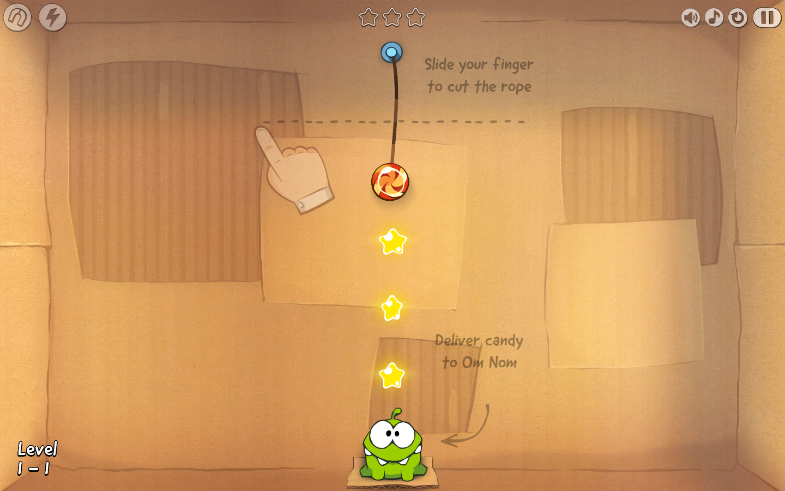
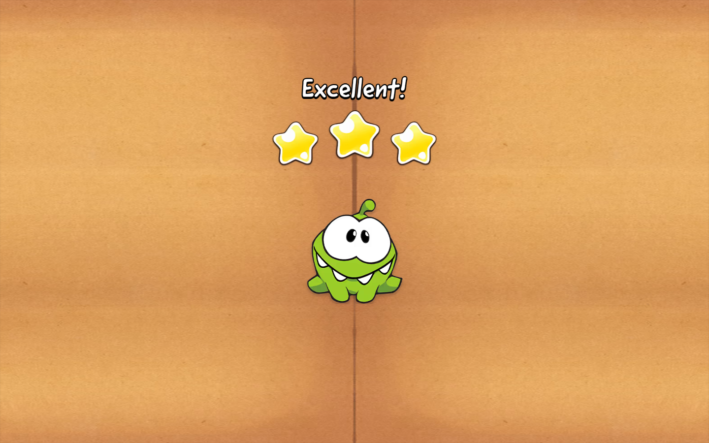
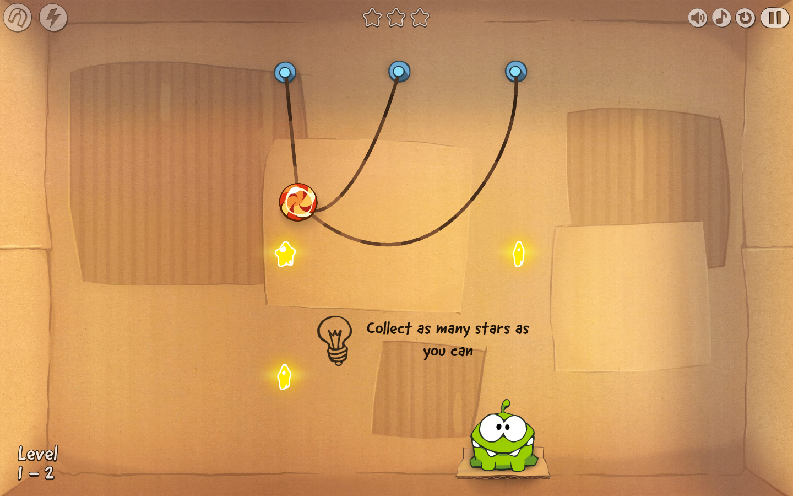

# Cut the Rope / 割绳喂糖 游戏规格说明书

格式版本：V5.1

仅记录有依据的实现层事实；内容字段非必填，未知留空，不代表不存在或已经验证。

## 1. 基础事实

**维度定义**：让读者第一眼知道“这是什么类型、什么操控体验的游戏”，以及它的技术栈。

**内容说明**

Cut the Rope / 割绳喂糖，MSN原生9npxcz4n8jw7。原Ctrr v1.6.20（2025-05-28），Haxe4.3.4 polygonal编译JavaScript，2D WebGL。远端52真实1440×900画布；非现有4k99悬球碰瓶Cocos项目。

## 2. 资源类型

**维度定义**：游戏中游戏内容元素的资源类型是什么——即在哪个引擎运行下的资源格式。

**内容说明**

406运行/407取得的原文件，404个原声明静态资源全部HTTP200且SHA留存，含PNG/JPG/AVIF图集、JSON帧表和地图、原DAT字形/加载资源、OGG/AAC音频和MP4动画。原17盒×25图共425地图保留。发布JS长度元数据只有menu/ui.json声明24561、实际源23621不同，其余403项大小一致；保留实际源字节，不伪造缺少的940字节。

## 3. 核心挑战维度

**维度定义**：游戏核心玩法主要挑战 / 满足人的什么。

**内容说明**

选择时机和顺序切断悬挂糖果的绳索，借原物理运动收集星星并送入Om Nom口中，避免障碍或掉出有效范围。本次首关一条绳，普通横划后三星并通过；第二关三绳画面只进入未操作。

## 4. 操控方式

**维度定义**：操控本身的复杂度 + 需要玩家判断的时机 / 策略复杂度。

**内容说明**

原鼠标按下/连续移动/释放或触摸划绳；普通点击Play、Collect和Next。本次唯一拖动为可见绳索上的(590,220)→(840,220)，未调用切绳处理器或改物理。加载1步、3次普通点击和1次普通拖动，共5步。

## 5. 行为路径

**维度定义**：玩家一局里重复做什么。

**内容说明**

累计5步：加载原菜单→普通Play进入Level1-1→一次横向划过可见绳索，原糖果下落、星星收取与喂食→原Drawing found/Collect→原Excellent三星结果与普通Next进入Level1-2。另2次只观察未加输入，7张实际截图均已打开。没有调用业务方法、读隐藏关卡解法或写分数/关卡/奖励。

## 6. 游戏路径（关键节点 + 流失风险）

**维度定义**：从开始到结束的流程 + 每个关键节点的潜在流失风险点。

**内容说明**

原菜单→首关绳/糖果/三颗星/Om Nom及划动教学→真实划绳→原过渡→Drawing found并Collect→原Excellent与三星→Next到Level1-2。只实测首关三星、原绘画收集和进入第二关；未操作第二关、撤销/重试/设置、广告道具、存档刷新或其他424关。最终50同源请求/50个200，无外联/失败/console error或warning。

## 7. 成长路径

**维度定义**：玩家如何推进变强。

**内容说明**

原本地存档键Ctrr、星级/盒与关卡/画册收集结构保留；实际首张图收集和下一关进入，原画册按钮出现1徽标。未刷新，因此不把代码保存路径当已实测恢复。

## 8. 核心闭环（目标-规则-反馈-激励）

**维度定义**：游戏是否具备“明确目标 → 明确规则 → 达成反馈 → 奖励激励 → 下一目标”的完整闭环。

**内容说明**

读可见绳索、糖果、星星、目标与机关→普通划绳/按机关→原物理改变糖果路线→收星和喂食→原结果星级/收藏→下一关。首关完整闭环已观察，后续复杂机关未逐关验证。

## 9. 玩法规则

**维度定义**：核心循环、玩法规则、目标与进度。

**内容说明**

原糖果/绳索/星星/目标、原重力/碰撞与判定类字节保持。没有改地图、星数、得分、解锁阈值或时间/随机数。普通原回调去掉外部分析等待后沿原本地结果继续，Collection来自该关实际通过。

## 10. 数值配置

**维度定义**：影响玩法的关键数值。

**内容说明**

5累计输入/7截图；首关3星，Level1-1→1-2，原画册徽标1。17盒425配置、404声明资源；50请求/50个200、0外联/失败/error/warning。Token、价格、纯处理和等待未独立计量，保持未知。

## 11. 关卡配置

**维度定义**：关卡结构、递进规律、难度曲线。

**内容说明**

res/box01至box17/maps.json各25条，共425原配置；本次只完成1-1并进入1-2，不称425关全通。原泡泡、尖刺、蜘蛛、吹气/重力/传送等配置与资源保留，未对每种机关实测。

## 12. 系统设计

**维度定义**：功能系统清单、UI 流程。

**内容说明**

物理移除Famobi SDK/分析包装器及真实生命周期、广告、遥测消费端；将原普通游戏继续函数排入浏览器微任务，不造SDK成功或奖励回调。实际浏览器localStorage保留原存档键/结构。原剩余道具次数使用路径保留，空次数广告请求及父类模拟广告补充处理器移除，不免费补充。391个原类字节保持、2384个保留方法规范AST一致；12个服务边界类有修订，36个方法修订，不改原物理、切绳/碰撞、地图、随机、计分或解锁规则。 原原生语言规范化、视口适配、WebGL/图集、粒子/绳索动画、声音和本地进度保持。单机入口用实际浏览器语言进入原Ctrr.main，画布偏移为无平台覆盖物的视口边界。

## 13. 主题化包装

**维度定义**：游戏的题材 / 世界观包装。

**内容说明**

原纸箱纸纹、剪刀字标、红白糖果、蓝色绳锚点、黄色星星、绿色Om Nom、橙色菜单与结果按钮和原照片收藏；全部为本次原游戏运行截图，未替换原图/仿造界面。

## 14. 养成系统 + 经济系统

**维度定义**：玩家如何成长、经济如何循环。

**内容说明**

原星级、盒/关卡解锁、画册收集与剩余本地道具次数使用保留。广告补充和父类模拟发放移除；空次数按钮保持原不可用状态，未改计数/免费赠送。实际只首关三星/一张图，不声称其他收益。

## 15. 角色 / 单位设定

**维度定义**：有哪些角色/单位、各自定位（玩法层面）。

**内容说明**

原Om Nom、糖果/星星/绳锚点、机关与背景。真实看见Om Nom首关喂食后结果角色、糖果下落、绘画收集和第二关三绳；其他角色皮肤/全部动画未检验。

## 16. 商业化

**维度定义**：靠什么变现。

**内容说明**

交付不接广告、支付、线上身份、服务器排行或联机；无SDK替身、广告成功/付款成功或服务端协议伪造。原本地道具余量继续能消耗，但不提供广告补充。原出版素材与署名来源保留，用户标签gcy不作为授权文件。

图 1：原首关划绳喂糖教学

图 2：原Excellent三星结果

图 3：进入原第二关三绳地图
