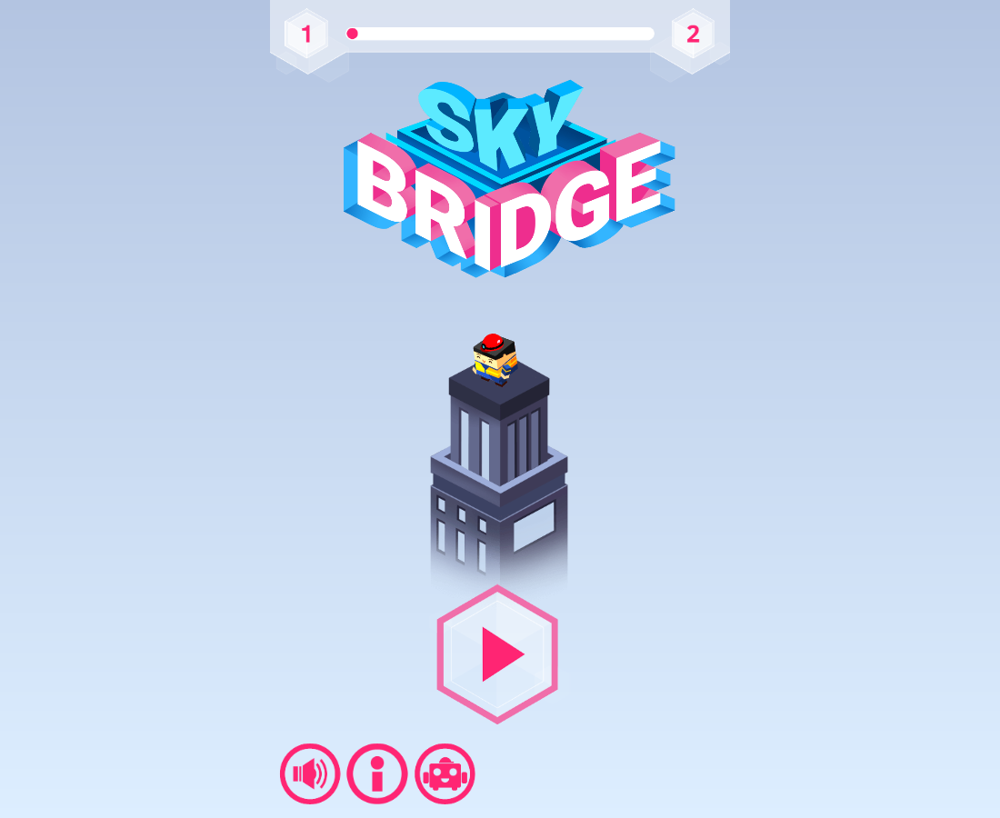
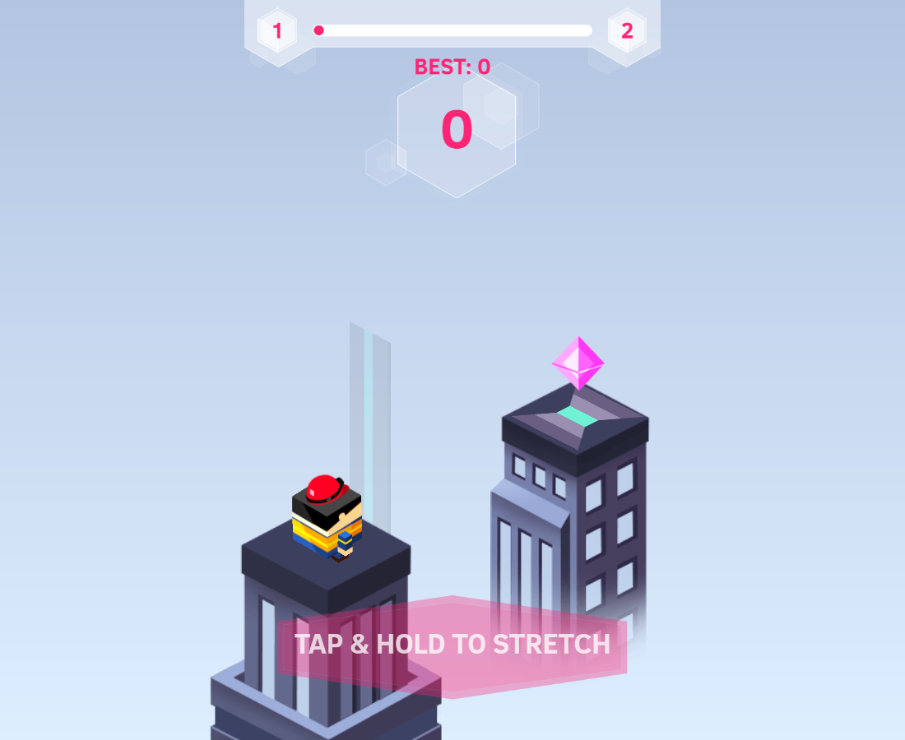
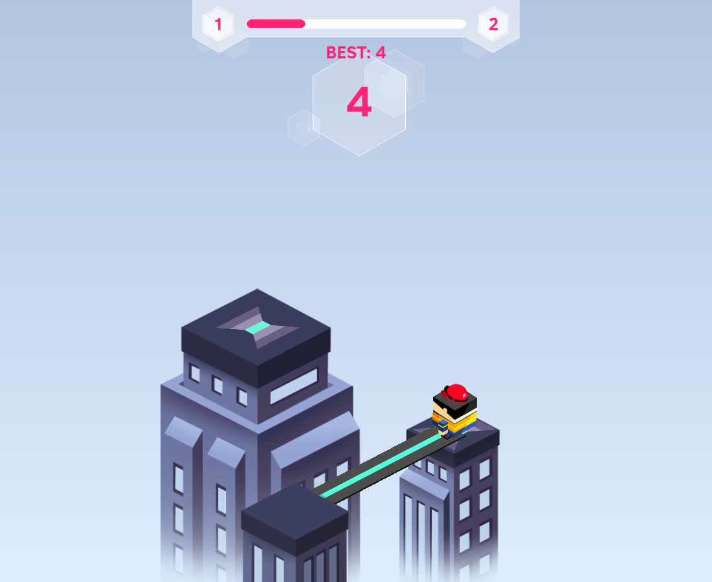
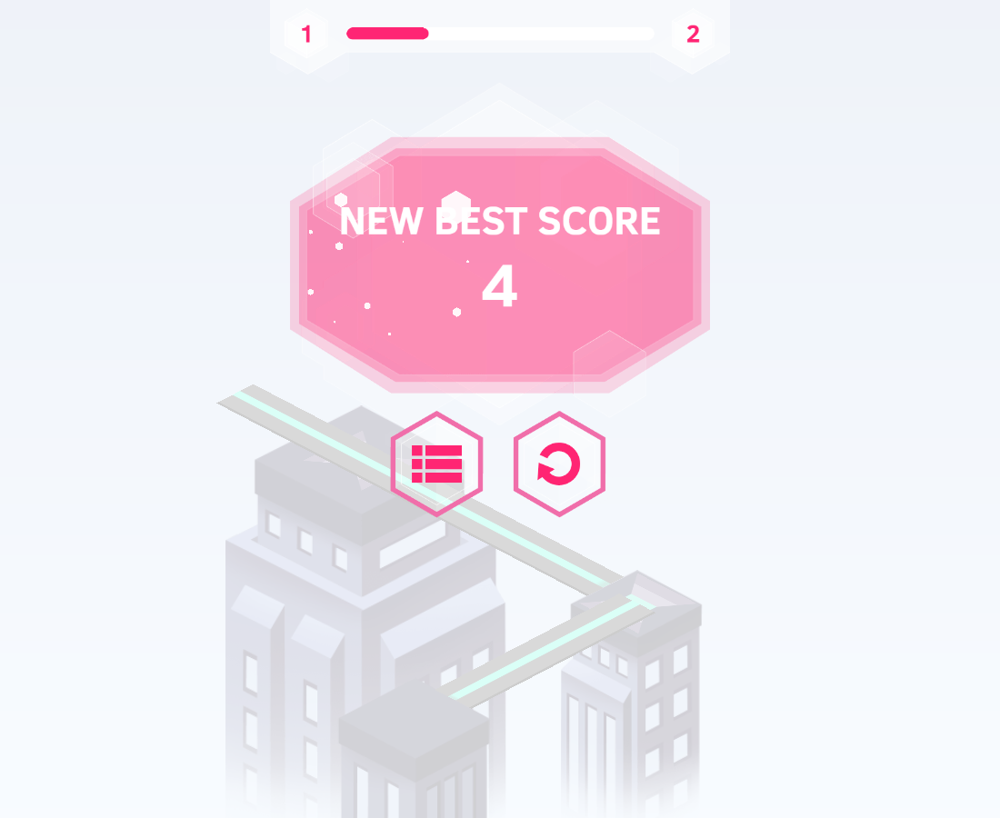

# Sky Bridge Classic 游戏规格说明书

格式版本：V5.1

仅记录有依据的实现层事实；内容字段非必填，未知留空，不代表不存在或已经验证。

## 1. 基础事实

**维度定义**：让读者第一眼知道“这是什么类型、什么操控体验的游戏”，以及它的技术栈。

**内容说明**

MSN9pll61343jrg，Sky Bridge Classic、原目录20-cdn/h5/skyBridgeFree；实际原Cocos Creator2.0.5/JavaScript/HTML/CSS，等距2D场景、Spine角色。桌面1100×900实际浏览器；手机未测。此前资源分析将其称1.x为配置形态推断，已以真实cc.ENGINE_VERSION2.0.5更正。

## 2. 资源类型

**维度定义**：游戏中游戏内容元素的资源类型是什么——即在哪个引擎运行下的资源格式。

**内容说明**

原81项二进制原资源：48PNG、32MP3、1TTF；两个Cocos资源包含245个资产条目和239个序列化UUID引用，闭包无缺失。43份Spine骨骼JSON与atlas原已内嵌；原引擎preventPreloadNativeObject不加载其raw-skeleton.json字段。97运行文件中94原字节一致。

## 3. 核心挑战维度

**维度定义**：游戏核心玩法主要挑战 / 满足人的什么。

**内容说明**

观察屋顶间距，按住使桥梁生长、松开让桥梁转落；桥长落在目标平台范围才可通行，过短或过长按原判定坠落。教程有原生标尺和长度上限辅助；本轮只实际通过教程桥，第二次非教程桥失败。

## 4. 操控方式

**维度定义**：操控本身的复杂度 + 需要玩家判断的时机 / 策略复杂度。

**内容说明**

原Play按钮开始，空白玩法区域普通鼠标按住与松开控制桥长；原Input绑定TOUCH_START/END/CANCEL/MOVE并由引擎处理浏览器输入，未调用游戏输入或桥梁业务函数。音量/说明/角色面板入口保留未操作。

## 5. 行为路径

**维度定义**：玩家一局里重复做什么。

**内容说明**

原标题/主菜单→原Play→教程TAP & HOLD TO STRETCH→按住/松开→原桥转落、角色行走、PERFECT/+4→教程标记结束→新楼顶间距→第二次按住/松开→原桥过长/角色坠落→NEW BEST SCORE4及原返回/重玩按钮。

## 6. 游戏路径（关键节点 + 流失风险）

**维度定义**：从开始到结束的流程 + 每个关键节点的潜在流失风险点。

**内容说明**

实际走通原引导过桥及普通失败结算；第二次桥没有过关，不把失败写成第二次成功。第五步刷新停在原加载图，未验证存档恢复。长局、角色选择、其他楼顶布局、重玩和手机均未测。

## 7. 成长路径

**维度定义**：玩家如何推进变强。

**内容说明**

原顶部角色等级1→2的进度条、本地最佳分、角色经验和合法解锁逻辑保留；本轮分数/最佳0→4，顶部仍等级1。原StorageManager/localStorage代码未改，刷新读取结论未知。

## 8. 核心闭环（目标-规则-反馈-激励）

**维度定义**：游戏是否具备“明确目标 → 明确规则 → 达成反馈 → 奖励激励 → 下一目标”的完整闭环。

**内容说明**

观察当前/目标楼顶→按住增长桥→松手转落→原长度比较→原角色行走或坠落→成功得到原计分/经验与下一间距，失败显示本地结果并提供原重玩/返回。目标为连续跨越与提高本地最佳。

## 9. 玩法规则

**维度定义**：核心循环、玩法规则、目标与进度。

**内容说明**

原BridgeControl.compareBridgeLength按平台中心距、半宽和padding分过短/过长/普通/完美；按住增长、松开转落、通过才推进ColumnGeneration，角色碰撞/坠落/动画和随机楼高/间距未改。教程自身使用getPerfectDistance上限和可见标尺，未删除教程或人为降低难度。

## 10. 数值配置

**维度定义**：影响玩法的关键数值。

**内容说明**

源码默认m_GrowSpeed6、旋转速度200、等距角27.4度；增长由原更新循环控制，不声称固定真实每秒速度。本轮两次各1100ms真实鼠标按住；原分0→4、最佳0→4，当前桥计数初始化1→2，不把初始化计数1当已通过一桥。

## 11. 关卡配置

**维度定义**：关卡结构、递进规律、难度曲线。

**内容说明**

原ColumnGeneration随机建筑与间距、BridgeControl参数、建筑/桥梁预制体保留。单一原Plank场景驱动连续流程，不把245资产/43骨骼或197包条目当关卡数量。实际一次原引导成功和一次普通失败。

## 12. 系统设计

**维度定义**：功能系统清单、UI 流程。

**内容说明**

46原模块中37完整函数体保持原字节，6云数据/排行榜及在线里程碑模块移除，仅ButtonBehaviour/GameManager/ScoreManager三模块定向修改。桥梁/输入/角色移动/列生成/普通角色成长/本地存储原模块完整保留。场景包197条目不移位，195资产对象完全相同，仅服务组件/入口关联修改，剩余对象引用无悬空。

## 13. 主题化包装

**维度定义**：游戏的题材 / 世界观包装。

**内容说明**

原粉蓝等距城市楼顶、青绿色桥心、方块小队/红帽角色、粉色六边形Play与计分/NEW BEST SCORE面板、原Spine行走/落下和转桥动画；配图为本轮真实截图，含刷新停留加载图。

## 14. 养成系统 + 经济系统

**维度定义**：玩家如何成长、经济如何循环。

**内容说明**

保留原本地角色等级/经验/解锁列表和最佳分，不赠送角色、经验或在线排名奖励。原在线排行榜用户名/服务时间/王者奖励入口与调用移除，普通本地游戏结束直接使用原本地结算分支。没有伪造云存档或排行榜返回。

## 15. 角色 / 单位设定

**维度定义**：有哪些角色/单位、各自定位（玩法层面）。

**内容说明**

实际原红帽方块队伍跨楼、普通Spine动作；原角色面板配置含普通和隐藏角色资源，未在本轮选择或解锁，不宣称全部角色测试完成。

## 16. 商业化

**维度定义**：靠什么变现。

**内容说明**

广告/追踪/外链包装器与ludiSDK不进入运行包；项目中ShowAds、在线排行榜/数据库模块、姓名弹窗/找自己/排名奖励按钮及调用物理退役，未使用SDK替身或奖励成功回调。无原联机核心或真实支付功能。原合法本地成长保留。完整观察未出现外联请求。

图 1：原菜单

图 2：原教程与可见桥长标尺

图 3：原教程过桥PERFECT/+4

图 4：第二桥真实过长及原NEW BEST SCORE4结算

图 5：未通过的刷新：本地连接拒绝，停留加载画面
