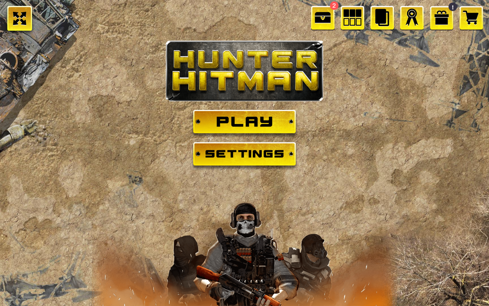
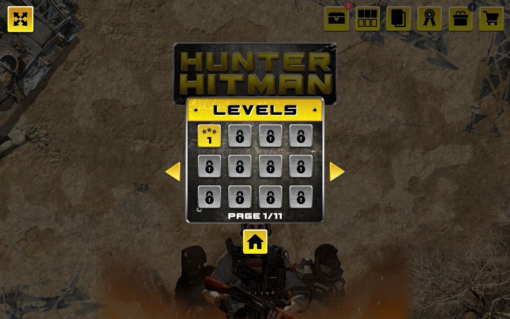
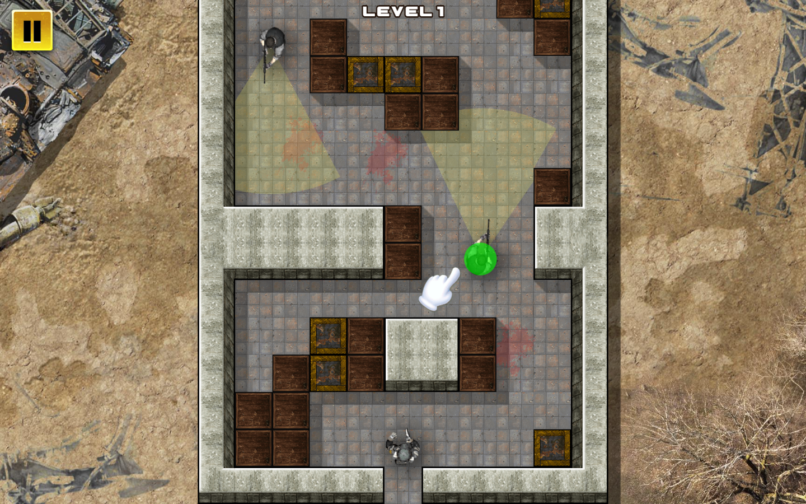
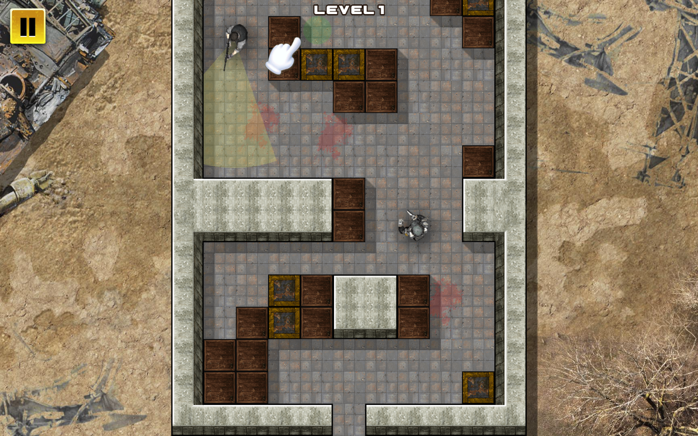

# Hunter Hitman 游戏规格说明书

格式版本：V5.1

仅记录有依据的实现层事实；内容字段非必填，未知留空，不代表不存在或已经验证。

## 1. 基础事实

**维度定义**：让读者第一眼知道“这是什么类型、什么操控体验的游戏”，以及它的技术栈。

**内容说明**

MSN9n8bq7npxbfw，Hunter Hitman v15原入口；内部MJS-Hunter-Hitman-microsoft，游戏1.0.4/框架1.1.2。JavaScript、HTML、CSS，ImpactJS二维俯视角色与地图，原Howler音频。桌面1440×900实测，内部1728×1080；实体手机未测。

## 2. 资源类型

**维度定义**：游戏中游戏内容元素的资源类型是什么——即在哪个引擎运行下的资源格式。

**内容说明**

219份首批原音效/图像/字体及4份开场补齐资源，全部原字节/SHA保留；原背景、军装角色、守卫、视野扇形、箱子/墙体/地砖、原菜单与关卡面板。132份关卡数据和角色动画原代码保留。原FontInfo只声明WOFF/TTF，通用下载计划额外试探的两个WOFF2原404不是运行依赖；不伪造字体。

## 3. 核心挑战维度

**维度定义**：游戏核心玩法主要挑战 / 满足人的什么。

**内容说明**

点击目的地，原寻路绕过墙体及箱子，观察守卫可见视野，从身后接近触发原刺杀。首关第一次原教程目的地移动、攻击与现金反馈已实测。

## 4. 操控方式

**维度定义**：操控本身的复杂度 + 需要玩家判断的时机 / 策略复杂度。

**内容说明**

鼠标原Play→关卡1→可见绿色手势目标一次点击。普通输入均move→100ms→down→80ms→up，没有调用移动/攻击方法、写角色状态或绕过教程；原暂停、声音、全屏和本地养成入口保留但本轮未操作。

## 5. 行为路径

**维度定义**：玩家一局里重复做什么。

**内容说明**

修订菜单→原Play→关卡页1/11，唯一关1可选，其余锁定→关1俯视地图与两名守卫、原绿色手势→点击后原角色沿路径移动并刺杀一名守卫，下一教程手势出现。

## 6. 游戏路径（关键节点 + 流失风险）

**维度定义**：从开始到结束的流程 + 每个关键节点的潜在流失风险点。

**内容说明**

累计5检查点/5输入：首次v3启动缺开场字体停留原开场；补齐原logofont三格式及漏装横屏图后，第二步在新不可变v4进入原菜单，第三步Play，第四步选择唯一解锁关1，第五步点击原绿色手势目标。原玩家由(440,1080)移动到(600,680)，原守卫击杀0→1、剩余2→1，原随身现金0→100，生命30不变、教程0→1；截图已查看。只读010用于等待实际画面呈现，无点击/额外开局。未完成首关/三段教程、结算、刷新存档、全部132关或全部养成。

## 7. 成长路径

**维度定义**：玩家如何推进变强。

**内容说明**

原132关、逐关星级/分数解锁、本地服装/能力/卡牌组合/战利品箱、成就与普通日历奖励源码保留。首关进度及一次击杀实测，未完成整关和后续解锁，没有免费跳关或生成高级存档。

## 8. 核心闭环（目标-规则-反馈-激励）

**维度定义**：游戏是否具备“明确目标 → 明确规则 → 达成反馈 → 奖励激励 → 下一目标”的完整闭环。

**内容说明**

观察墙体及守卫朝向→点击安全位置→原A*寻路/角色移动→从后方接近的原攻击判定→击杀、现金及剩余敌人反馈→继续处理剩余守卫，原规则满足后进入结算与下一关。本轮只到第一次击杀，结算环节为源码确认。

## 9. 玩法规则

**维度定义**：核心循环、玩法规则、目标与进度。

**内容说明**

原玩家/敌人/教程/A*方法及132关函数体精确字节一致。原守卫视野、追逐、受伤、攻击距离、碰撞与路径约束保留。失败、首关全部目标、星级结算均未追加试玩；广告翻倍与广告跳关提供者/控件/回调退役，不伪造成功奖励。

## 10. 数值配置

**维度定义**：影响玩法的关键数值。

**内容说明**

实测生命30→30、击杀0→1、敌人2→1、随身现金0→100、教程0→1。源码普通结算分数含随身现金+20×剩余生命，并有基于36秒的原时间奖励；未运行结算，不把随身现金100当作已入账结算或最终分。原初始存档cash0、只开放关1及默认服装保留。

## 11. 关卡配置

**维度定义**：关卡结构、递进规律、难度曲线。

**内容说明**

原132关LevelLevel1…132，选关12项/页、11页；全量地图、实体、图层和关卡资源引用保持。实际只进入关1并击杀第一名守卫，尚余1名，不声称通关或132关验收。

## 12. 系统设计

**维度定义**：功能系统清单、UI 流程。

**内容说明**

69处精确原源码范围改动，退役8个服务/广告/分享/更多游戏模块及其依赖、UI和调用。原A*、玩家、敌人、教程与132关共138个函数体SHA及字节完全保留。字体漏项以真实源文件补齐；独立版本v4仅比v3增加4资源，game.js完全相同。两个真实浏览器均已正常关闭/exit0。

## 13. 主题化包装

**维度定义**：游戏的题材 / 世界观包装。

**内容说明**

原沙漠军事基地、灰色地砖、棕色箱体、浅灰墙面、持枪守卫及黄色可见视野、绿色目标/白色教程手，黄黑金属菜单和关卡锁定面板。使用原资源实显，未以占位图或简单几何替换。

## 14. 养成系统 + 经济系统

**维度定义**：玩家如何成长、经济如何循环。

**内容说明**

原本地cash、服装价格和Stealth/Defense/Speed能力、卡牌与组合、战利品箱、成就奖励/日历奖励保留真实条件。实际只得到原单局随身现金100，未领奖、开箱、购买、升级或验证日历；没有联网支付或免费解锁。

## 15. 角色 / 单位设定

**维度定义**：有哪些角色/单位、各自定位（玩法层面）。

**内容说明**

原玩家特工、普通/教程守卫、后续原敌人变体、墙体/箱体/地砖及教程手。两名原关1守卫从2变1，玩家原行走/攻击表现可见；完整变体及所有动画未逐项实测。

## 16. 商业化

**维度定义**：靠什么变现。

**内容说明**

Microsoft/API、旧广告布局和实例、分享/外链、广告跳关、广告奖励/翻倍全部物理退役，未提供SDK替身或伪造身份/广告/付款。独立Howler前的发行域跳转about:blank提供者及唯一调用退役，不伪造hostname，保留原音频定义和所有游戏检查。原普通本地金币成长继续；无新增后端。

图 1：原菜单，纯等待后的实际渲染

图 2：原11页132关，关1解锁

图 3：原首关：两名守卫及首次手势

图 4：原移动与第一次击杀后：下一手势/剩一名守卫
