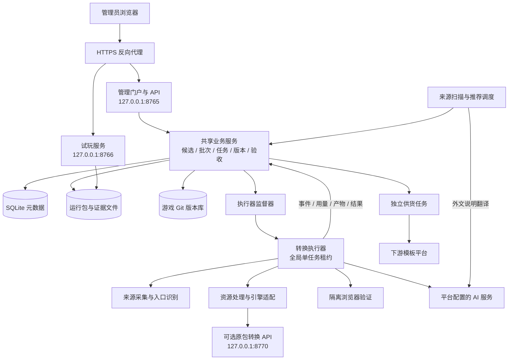
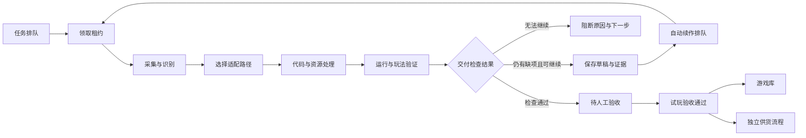
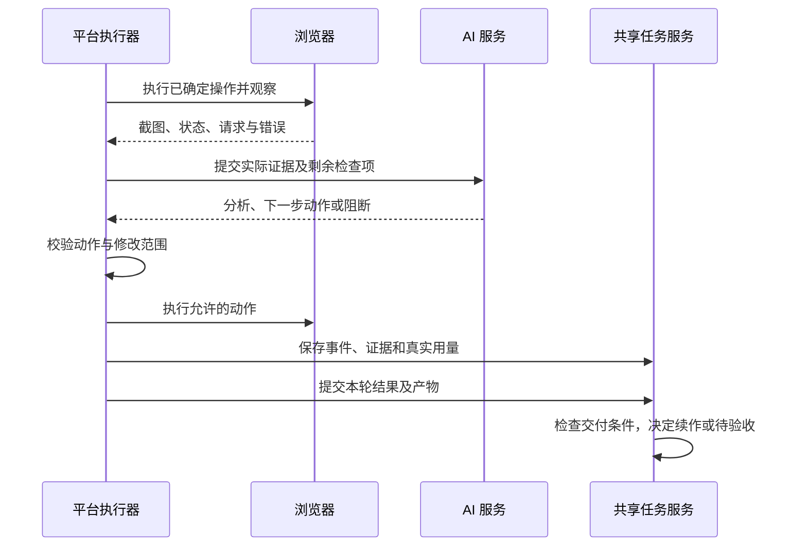
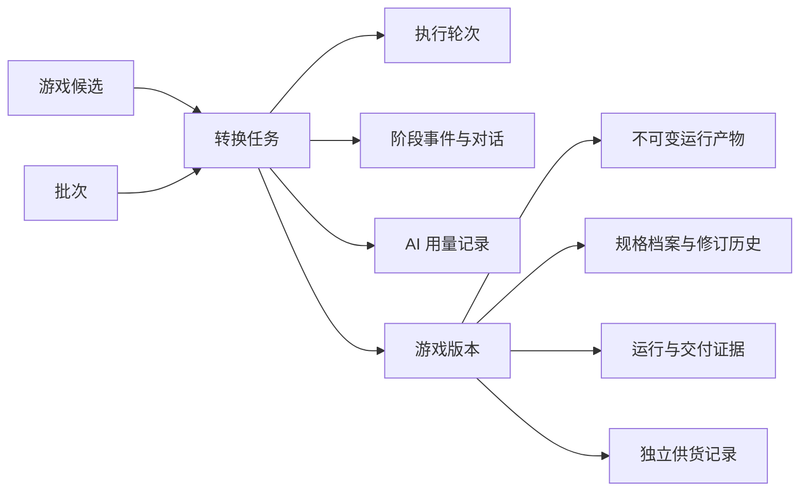

# Game Lab 游戏转换平台架构说明书

版本：1.0
编写日期：2026-10-22
适用对象：项目负责人、开发人员、测试与运维人员、交付接收方
说明范围：当前仓库实现及现有 Windows 云端部署。规划能力单独列出，不作为已交付功能。

本日云端交付升级：生产数据统一到 `C:\GameLab\shared`，平台按已推送的 Git 提交构建发布包，以版本目录切换发布。账号升级为项目内共享数据的管理员、操作员、只读用户三种角色，会话持久化且可撤销。具体目录、发布、回退及备份命令见 [云端生产交付手册](CLOUD_DELIVERY.md)。下文相对 data、game-library、runs 路径对应统一生产目录，不能视为发布包内可覆盖的数据。

## 1. 平台定位

Game Lab 是围绕小游戏采集、适配、验证与交付建立的管理平台。平台将来源建议、转换执行、AI 辅助处理、浏览器验证、人工验收、版本管理和资源统计连接成可追溯流程。

平台的主要输入包括游戏网页链接、微信小游戏分享链接、已有源码或运行包；输出包括可试玩的 Web 游戏版本、可用代码与资源、游戏规格说明书、执行证据和用量记录。

平台优先保留现有游戏代码与资源，按已支持的来源和引擎选择适配路径。在明确要求且具备材料时，才进入 AI 重建或修改路径。网页可访问、引擎识别成功、浏览器启动成功、玩法检查通过及人工验收通过是不同结论。

### 1.1 当前架构特点

- 管理端采用原生 JavaScript 与 CSS，静态加载，无前端构建步骤。
- 后端采用 Python 标准库 HTTP 服务和共享业务模块，不是分布式微服务集群。
- 转换任务由独立执行器进程领取；耗时采集、适配及浏览器操作不在门户请求中同步执行。
- SQLite 保存业务元数据；文件系统保存大体积产物与证据；独立 Git 仓库记录游戏代码版本。
- 当前云端全局同时执行一个转换任务，其余任务排队。
- AI 负责分析和提出操作或修改方案，实际执行、证据保存与状态判定由平台控制。

## 2. 总体架构

图中的扫描、执行器监督与供货调度是不同的后台职责，不表示当前已分别部署为独立集群。管理与试玩默认可由同一 Python 主进程监听两个本机端口，转换执行器则为子进程。

## 3. 模块组成与职责

| 模块 | 主要职责 | 核心代码 |
|---|---|---|
| 门户界面 | 来源建议、任务中心、验收、游戏库、统计与服务配置 | `web/app.js`、`web/dashboard.js`、`web/*.css` |
| HTTP 与访问控制 | 管理 API、静态页面、登录会话、请求校验及试玩路由 | `server.py` |
| 共享业务服务 | 候选、批次、任务、工具、产物和版本的事务操作 | `controlplane/service.py` |
| 元数据存储 | SQLite 事务、实体读写、事件保存 | `controlplane/store.py` |
| 任务对话与续作 | 用户要求、轮次记录、基线版本和接续上下文 | `controlplane/conversations.py`、`revision.py` |
| 过程展示 | 按轮次整理阶段、状态、时间线与实际进展 | `controlplane/pipeline.py` |
| 来源发现 | 定时扫描、页面解析、去重、分类、建议选择和派单 | `discovery.py`、`discovery_scan.py`、`selection.py` |
| 中文说明 | 外文玩法说明翻译、原文保留、译文展示 | `controlplane/discovery_language.py` |
| 执行器监督 | 注册工具、启动 worker、监测退出、管理本机转换依赖 | `controlplane/executor.py`、`package_service.py` |
| 转换执行器 | 领取任务、预算控制、采集、分流、适配、验证与提交 | `executors/worker.py` |
| Web 适配与验证 | 网页入口采集、Cocos／Ruffle 适配、交互观察与续作 | `executors/discovered_web.py`、`discovered-web.cjs`、`web-capture.cjs` |
| 原包转换 | 已适配 Cocos 原包的上传、异步转换和结果下载 | `services/wechat-web-service/` |
| AI 接入 | API 协议适配、流式响应解析、失败处理及真实用量采集 | `controlplane/ai_provider.py` |
| 交付检查 | 基础交付缺项、依赖、游戏规格与检查结果 | `delivery_requirements.py`、`dependencies.py`、`game_specs.py` |
| 产物与代码版本 | 文件校验、不可变产物和 Git 版本记录 | `controlplane/repository.py` |
| 展示与说明书 | 通用视口设置、版本绑定的游戏事实、Markdown 输出 | `presentation.py`、`runtime_viewport.py`、`game_catalog.py` |
| 统计账本 | Token、费用估算、执行耗时及游戏维度汇总 | `usage.py`、`dashboard.py`、`dashboard_operations.py` |
| 下游供货 | 分发条件检查、打包、签名提交、轮询与回传 | `supply.py`、`supply_prepare.py`、`supply_service.py` |

同一业务行为应落在共享服务层，使自动转换、续作、本地导入与展示使用一致规则。前端不根据特定游戏名称或 ID 编写展示特例，游戏差异通过版本元数据表达。

## 4. 业务主流程

### 4.1 采集建议到转换

1. 来源扫描调度读取已启用来源、扫描时间和数量限制。
2. 解析公开页面，提取游戏名称、链接、品类与玩法说明；按规范化链接去重。
3. 对外文玩法说明生成中文译文，保留来源正文。说明来自公开页面，不等于已试玩。
4. 建议进入“待选择”。人工通过后进入“待抓取”；拒绝记录保留，后续扫描抑制重复建议。
5. 用户发起转换后建立或复用候选、批次与任务。只有显式启用自动选择和自动派单时，规则才可自动推进。
6. 任务进入共享队列，执行器取得有效租约后开始工作。

### 4.2 转换、验证与交付

基础玩法验证以代表性闭环为界：进入真实玩法、有效操作、反馈或阶段结果、继续或重试，以及适用时的保存恢复。未访问内容单独记录边界，不要求为完成基础交付无限追加后续关卡。

“可试玩草稿”表示已存在可运行版本，但仍有交付检查缺项；“待人工验收”表示平台检查结束；“已验收”表示人工确认玩法和画面；“已发布”属于独立发布状态。这些状态不可互相替代。

### 4.3 主要转换路径

| 输入或路径 | 当前处理方式 | 边界 |
|---|---|---|
| 可识别的 Cocos 2 Web 发布包 | 发现入口、采集脚本与资源、适配宿主、离线启动与交互验证 | 不代表支持所有 Cocos 游戏或在线后端 |
| 声明 SWF 的 Ruffle 宿主 | 保存 SWF 与运行引擎，适配播放器宿主并验证 | 不等于恢复 SWF 的原始可编辑工程 |
| 已登记 Web 方案 | 按已知资源、脚本与宿主契约执行 | 特定方案成功不自动扩展成所有同类游戏均可用 |
| 已适配的 Cocos 3.5.1／define 原包 | 调用独立原包 API，处理包、插件与运行输出 | 需要匹配的主包、分包及插件材料 |
| 内嵌 HTML／静态源码 | 按显式资源映射和已有源码整理，执行分析与运行检查 | 构建关系、动态服务及完整工程不保证恢复 |
| AI 重建或续作 | 基于真实材料、既有版本和用户要求分析、修改并验证 | 不是无材料生成后冒充原游戏恢复 |
| 本地导入 | 将已有运行包与相关材料登记到平台版本体系 | 导入成功本身不证明玩法或全资源完整 |

现有游戏库中包含 Unity、Laya 等案例，并不意味着已具备对应引擎的通用自动转换器。未知引擎、不可访问资源和无法替代的在线依赖应产生明确阻断。

## 5. 任务调度、状态与续作

### 5.1 单任务执行与排队

当前最大转换并发数固定为 **1**。限制位于服务端领取事务中，不依赖前端按钮或某一个 worker 的自律。

- 领取时检查全局正在运行的任务、任务状态、工具能力、批次状态及尝试上限。
- 多次提交可以创建多个排队任务，但不会同时启动多个转换。
- 手动发起、自动派单、重试和续作使用同一名额限制。
- 自动续作记录新的入队时间，回到队列中等待。
- 暂停批次不领取；等待人工回复、阻断和待验收任务不占执行名额。
- 页面显示可执行队列的位置；工具能力和批次状态可能影响实际领取，不承诺等待时长。

此限制针对转换任务，并不表示 HTTP 请求、来源扫描、推荐翻译和供货调度全部串行；这些后台活动仍可能消耗 CPU、网络或模型额度。

### 5.2 租约与故障恢复

执行器通过工具凭证领取任务，服务端返回任务租约。心跳延长租约；事件、产物与最终结果必须匹配当前工具、任务和有效租约，过期执行结果不能直接覆盖当前任务。

租约超时后，任务根据尝试次数重新排队或记录失败。停止批次会撤销活动租约。执行器监督器负责重启异常退出的 worker；任务子进程负责具体执行。

平台保存中间产物与检查点，但进程恢复不等于浏览器现场恢复。已有代码产物可以复用；没有游戏存档时，不能宣称能够回到原来的角色位置或关卡画面。

### 5.3 多轮任务

同一任务可以包含多轮执行。每轮保留要求、结果、用量和事件，并关联基线版本。续作生成新版本，不覆盖已验收旧版本。

Web 自动续作受无进展次数、执行段数、动作数量、模型调用与时间预算限制。连续三轮验证状态与缺项数量无改善，或达到自动执行段数上限时，保留成果并阻断。通用修改检查点与 Web 自动续作使用各自的接续额度，不应混为“无限重试”。

### 5.4 过程展示规则

任务中心显示实际阶段与交付状态，不使用固定90%估计剩余工作。时间线以当前轮为主，历史轮次折叠保留；没有结束证据的步骤不能一直显示执行中，也不能据此推定成功。

当前主要节点为：发现与识别、获取代码与资源、解包与分析、Web 适配、运行与玩法验证、产物保存与入库、人工验收、发布。不同路径不一定经过每个节点，缺少记录应明确显示，而不是自动补齐为成功。

## 6. AI 与真实验证的职责边界

### 6.1 AI 接入

AI 适配层支持 Chat Completions 和 Responses API；代码也保留本机 Codex 模式及相关兼容逻辑。生产任务应使用平台显式配置的服务。开发人员的聊天会话不属于生产转换执行链。

模型接收当前任务所需的截图、观察记录、源码片段、历史要求及缺项清单，返回分析、建议动作或受约束的修改。Responses 流式调用需要终止成功事件才能作为完成结果，网络断流和不完整响应不能冒充成功。

### 6.2 实际执行闭环

AI 声明“完成”不能代替实际证据。平台检查运行结果、交付项及证据文件。Web 原包路径保护原游戏代码与引擎，允许的修复范围主要是宿主；不通过注入胜负、金币或存档伪造检查通过。

浏览器隔离运行可记录启动、动作、截图、网络请求和存储摘要。存储记录保留不等于游戏已正确读取进度，必须结合刷新后的画面或状态判断。当前浏览器与进程限制不是完整的容器级安全隔离。

## 7. 数据与文件架构

### 7.1 存储分工

| 存储 | 内容 | 设计目的 |
|---|---|---|
| `data/platform.sqlite3` | 候选、批次、任务、轮次、事件、版本元数据、建议、用量、供货等 | 用事务保证关键业务操作的一致性 |
| `data/artifacts/` | 不可变运行包、资源及提交证据 | 大文件独立于元数据存储 |
| `executors/runs/` | 每次执行的工作目录、观察、截图、检查点和本地用量日志 | 支持定位与受约束接续 |
| `game-library/` | 独立 Git 仓库中的游戏代码与版本记录 | 保留代码演进与可交付来源 |
| `game-library/catalog/` | 导出的游戏目录及版本规格说明书 | 提供可阅读的派生目录，不作为第二套元数据真相 |
| `data/services.json` 等私有配置 | AI、转换和相关服务设置 | 与公开源码分离，接口脱敏 |
| 原包服务私有数据目录 | 原包服务的凭证、任务与输出 | 保持服务边界和独立生命周期 |

SQLite 使用 WAL 和显式事务，主要业务实体存放在 `records(kind, id, data)` 表中，`data` 为 JSON；另有幂等与凭证相关表。该实现易于单机部署，但不等同于已建立分布式队列或跨节点一致性系统。

### 7.2 主要逻辑关系

此图表示业务引用关系，不表示数据库中已为所有关系建立 SQL 外键。关系合法性主要由服务层校验。

### 7.3 版本与游戏规格说明书

版本记录引用运行产物、报告、截图、试玩入口及展示元数据。游戏规格说明书按版本绑定，包含玩法类型、画面维度、视角布局、核心玩法、核心体验、操作方式、流程、内容规模、成长及存档十项事实。

历史说明补充通过 `game_profiles` 与修订历史登记，不覆盖旧运行包。文档由共享 `game_catalog` 逻辑生成，验收窗口通过登录保护的版本 Markdown 接口读取。当前支持页面阅读，下载功能暂不提供。

说明书描述游戏本身；工程依赖、恢复过程、复用边界和验证证据另行保留。字段齐全不等于所有关卡或数值已验证，未知项必须明确说明。

## 8. 统计与费用架构

平台将业务状态、执行时间和模型用量分开统计。

- **业务状态：**按候选、任务和版本汇总，区分草稿、待验收、已验收与供货状态。
- **执行耗时：**使用有起止记录的实际执行区间，并处理重叠区间；排队和人工等待不直接算成模型执行耗时，未闭合记录保留边界。
- **模型用量：**读取提供方实际返回的输入、输出和缓存 Token，不相信模型正文自报的使用量。
- **费用：**按配置币种、模型价格、缓存规则及长上下文档位估算。缺少用量或价格时记为未知，不按零费用处理。
- **推荐翻译：**记录为独立采集翻译用量，不混入某款游戏转换成本。
- **补传：**执行器保留本地用量日志；回传失败时保留待补传记录，避免为补统计重复调用模型。

费用统计是基于配置单价的估算，不替代服务商正式账单。服务探测、转换和推荐翻译等调用的统计覆盖，应按各自实际记录判断。

## 9. 接口与访问边界

| 接口类别 | 使用者 | 主要控制 |
|---|---|---|
| 门户页面与管理 API | 管理员浏览器 | 登录会话、Origin 与 CSRF 校验 |
| 工具任务 API | 内置或外部执行工具 | 工具 Bearer 凭证、能力限制与任务租约 |
| 试玩与运行包入口 | 已登录管理员 | 门户会话与产物路由控制 |
| 原包服务 API | 平台转换器 | 原包服务私有凭证、上传与任务额度 |
| AI API | 平台后端 | 服务端私有密钥、协议与响应校验 |
| 下游供货 API | 平台供货 worker | 独立配置、签名及协议校验 |

典型接口包括 `/api/conversions`、`/api/v1/jobs/claim`、任务的心跳／事件／完成接口、`/api/state` 和 `/api/versions/<id>/specification.md`。完整参数与错误约定见 [API 文档](API.md)。

当前门户支持项目内共享数据的管理员、操作员和只读用户，不提供公开注册或跨客户隔离。既有环境管理员仅用于首次初始化数据库账号；密码加盐哈希，会话以 Token 哈希持久化，12小时到期并可通过停用账号或修改权限撤销。工具凭证与用户会话相互独立。

## 10. 当前云端部署

现有部署采用 Windows 云服务器，应用目录为 `C:\GameLab\app`，对外通过 HTTPS 反向代理访问。

| 部署组件 | 当前作用 |
|---|---|
| HTTPS 代理 | 对外终止 TLS，将管理与试玩路径转发到固定本机上游 |
| `GameLabPlatform` 计划任务 | 启动平台及其后台组件，启动器在异常退出后尝试重新拉起 |
| `GameLabReverseProxy` 计划任务 | 托管反向代理 |
| `GameLabCertificateRenewal` 计划任务 | 证书更新与相关维护 |
| 8765 回环监听 | 门户、管理 API 与任务控制 |
| 8766 回环监听 | 游戏试玩和运行包服务 |
| 8770 可选回环监听 | 已配置时启用的原包转换服务 |

公网代理可将试玩映射为同一 HTTPS 站点下的 `/play/`、`/runtime/` 路径。因此，本机两个端口不能直接理解为公网已使用独立试玩域名；当前部署也不应被描述为完善的多租户沙箱。

生产浏览器需要与执行器锁定的 Playwright 版本匹配。游戏浏览器、AI 请求与资源采集是主要资源消费者；提高 CPU 和内存可缓解资源压力，但不能解决未知引擎、资源缺失、模型限流或在线依赖问题。

## 11. 运行维护与交付原则

### 11.1 备份

备份应覆盖平台数据库与私有配置、不可变产物、执行证据、完整游戏 Git 仓库、原包服务私有数据，以及供货所需分发文件。单独复制源码不能恢复完整平台。

需要写入一致性的备份应停写或使用 SQLite 备份机制；不能只复制一个正在写入的数据库主文件而忽略 WAL。恢复后核对目录、账户权限、Git、Node、浏览器版本、服务凭证和代理路径。

### 11.2 故障定位

| 故障表现 | 优先查看 |
|---|---|
| 任务始终排队 | 全局执行名额、批次是否暂停、工具在线状态和能力 |
| 入口无法识别 | 来源采集记录、iframe 链路、广告等待及运行引擎证据 |
| AI 429／超时 | 模型服务响应类别、供应方限额、预算与本轮检查点 |
| 验证反复续作 | 最新缺项、真实动作反馈、存档范围及无进展次数 |
| 游戏启动失败 | 缺失请求、控制台异常、浏览器版本与资源路径 |
| 统计费用未知 | 提供方 usage、价格配置、缓存与长上下文规则 |
| 验收后供货失败 | 独立供货记录、配置、分发条件与下游响应 |

### 11.3 修改与交付

共享服务修改应覆盖自动执行、续作、本地导入及展示，不仅修复某个按钮。历史产物不可覆盖，功能验收与资源使用记录分离。

回归使用隔离数据库和自有样例，不拿真实游戏执行测试性验收或重跑。交付说明应列出可修改逻辑、可移植模块、运行依赖和验证范围，分别标明“已验证可复用”“需拆解适配”“仅运行包”。

本架构说明书基于代码与已有部署记录编写，本次文档编写没有重新执行真实转换、性能测试或下游联调。

## 12. 当前限制与后续演进

| 当前限制 | 后续可选方向，尚不作为现有能力 |
|---|---|
| 单机 SQLite 与单转换并发 | 压力评估后引入数据库服务、专用队列与多 worker 调度 |
| 游戏运行与平台位于同机 | 增加容器或独立执行主机、资源配额及独立试玩域 |
| 项目内角色权限，不隔离客户数据 | 按后续需要增加组织与租户隔离 |
| 引擎适配范围有限 | 按真实样例逐项扩展适配器，并建立对应验证标准 |
| 基础闭环验证覆盖有限 | 建立按品类维护的用例、更多状态覆盖和可恢复存档策略 |
| 原发布包可维护性存在差异 | 提取共享模块、补充构建信息与二次开发文档 |
| 费用依赖提供方用量与价格配置 | 增加账单对账、预算提醒与限额策略 |
| 下游供货为独立集成能力 | 完成真实环境联调后再确认端到端发布交付 |

## 13. 配套文档

- [已确认服务要求](SERVICE_REQUIREMENTS.md)：需求与维护约束，以最新确认条目为准。
- [服务清单](SERVICES.md)：服务职责、端口与配置。
- [转换流程](AUTO-CONVERSION.md)：来源与处理路径。
- [运维手册](OPERATIONS.md)：安装、备份和故障定位。
- [API 文档](API.md)：管理与工具接口。
- [持续任务说明](MULTI_ROUND_TASKS.md)：多轮沟通和续作。
- [供货集成](SUPPLY_INTEGRATION.md)：下游协议与边界。

如旧文档中的默认并发、进度百分比、浏览器选择或引擎范围与近期实现不一致，应以当前代码和最新服务要求核对，不能将历史设计说明当作上线承诺。
