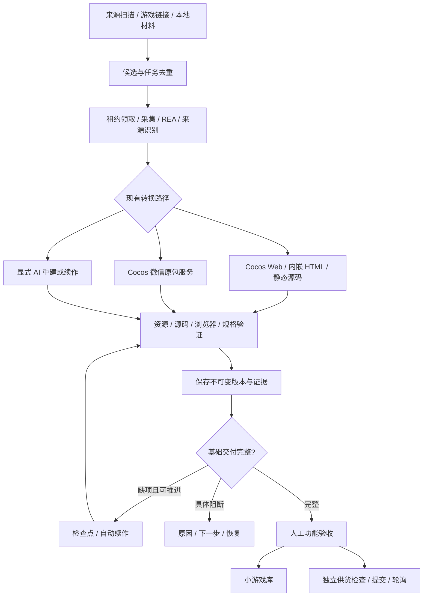

# 游戏转换流程与实现边界

更新：2026-10-21。当前部署见 [服务清单](SERVICES.md) 和 [运维手册](OPERATIONS.md)。

## 完整流程

1. 每日扫描来源页面与品类变化，生成采集建议；人工通过后派单，或启用明确允许品类的自动选择规则。
2. HTTP(S) 游戏地址、微信分享链接、本地源码/原包进入平台，共享候选、批次、版本服务。相同链接的活动任务去重。
3. 自动执行器领取自动任务，用租约、心跳、事件 ID 保护写入；人工批次由对应能力的工具领取。
4. 采集页面、匹配 AppID 缓存、提取显式资源索引，执行 REA，按来源与材料分流。
5. 下载/校验已知资源、适配宿主、执行浏览器和玩法规格检查；失败在预算内修复，明确缺项或阻断。
6. 保存不可变版本与证据；交付缺项未完整则自动续作，完整后进入待验收。不能只因页面可打开就认定还原完成。
7. 人工功能验收通过后进入小游戏库、移出候选页；续作不覆盖已验收旧版本。
8. 验收创建独立供货任务，经授权、静态包、签名及 HTTPS 下载条件检查后提交下游，轮询并处理问题；供货失败不回滚本地验收。

## 支持路径

| 路径 | 实现 | 实际边界 |
|---|---|---|
| Cocos 2 Web | `executors/web-profiles/`、`web_runtime.py` | 登记配置、脚本与资源校验，不是任意 Cocos 自动支持 |
| Cocos 3.5.1 原包 | `package_converter.py` → 独立 `/v1/jobs` 服务 | 明文/V1MMWX、define 包装，需主包/分包及匹配插件；built_unverified 不等于验收 |
| 内嵌 HTML/lib | `web_embedded.py`、REA、`embedded_runtime.py` | 显式资源映射与已知宿主契约，未支持在线服务/动态资源明确报告 |
| 静态源码 | 原始目录或受校验 ZIP、REA、source map、运行检查 | 保留已有代码和资源，不保证原作者工程、构建关系或全部可维护性恢复 |
| AI 重建/续作 | `ai_provider.py`、`continuation.py` | 必须有观察材料或不可变基线，分段读取、哈希约束修改、实际验证 |

未新增 Unity、Godot、Laya 通用转换器；库内人工导入或专项适配案例不构成通用能力证明。平台不具备读取原服务器私有逻辑、任意游戏自动通关或自动证明全量 1:1 一致的能力。

## 资源、证据与恢复

- 微信缓存按明确 AppID 匹配，额外目录由 `REPLICA_WECHAT_CACHE_ROOTS` 配置；网页链接不能获得另一台设备的缓存。
- REA 必须由平台执行器实际调用，证据与范围留在本轮运行目录。
- 远程资源按已取得索引/映射下载，校验 URL、数量、容量及 SHA-256，不猜未知分包、不用替代素材冒充。
- 静态引用、原始脚本、指定状态的渲染对照与组件测试分别保存证据；不能代替未覆盖玩法的实际验收。
- 自动续作共用状态与版本基线，连续三轮无验证进展产生具体阻断。单段调用额度用尽可检查点接续，最多连续三段；新要求/基线不能混用旧检查点。暂停、停止优先。
- 交付说明可修改逻辑、可移植模块、依赖及验证边界，区分已验证可复用、需拆解适配、仅运行包。

## 用量与协议

API usage 与 Codex JSONL 终态 usage 写入独立账本；历史未知不估算回填。执行计时区间取并集，未闭合记录明确标注，不将排队和人工等待算入执行耗时。

- `/api/conversions`：管理员会话和 CSRF 保护。
- 工具 claim/heartbeat/events/artifacts/complete：工具凭证、租约和事件绑定。
- 外部兼容 `/convert`：同步文件协议；原包 `/v1/jobs`：已实现的 ZIP 上传、异步轮询和下载协议，两者不能混用。
- 更多：[API](API.md)、[持续任务](MULTI_ROUND_TASKS.md)、[供货](SUPPLY_INTEGRATION.md)。
