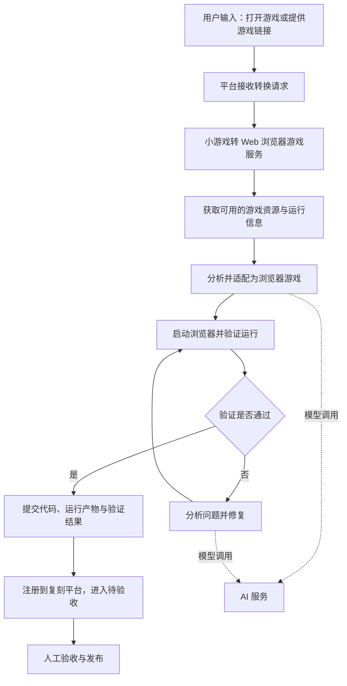

# 平台两类服务建设说明

> 历史设计稿（2026-10-14），下文“尚未实现”等是当时状态。当前已实现的转换链路、原包异步服务及新增下游供货，以 [服务清单](SERVICES.md) 和 [转换流程](AUTO-CONVERSION.md) 为准。

更新日期：2026-10-14

## 一、目标与范围

平台工具页面只按两类服务展示，不将反编译、浏览器操作、代码修改、运行验证等内部环节拆成独立服务卡片。

| 服务 | 职责 | 当前实现情况 |
| --- | --- | --- |
| 小游戏转 Web 浏览器游戏服务 | 接收游戏入口，完成转换、验证，并提交复刻平台验收 | 已实现配置和连接检测；独立转换服务端及任务派发适配尚待实现 |
| AI 服务 | 为游戏分析、代码生成和修复提供模型调用 | 已实现配置和实际模型调用检测，配置已接入现有执行器 |

本文只涉及 Web 浏览器游戏，不包含 Unity 案例和法务风险分析。

## 二、用户如何使用

### 游戏使用者

目标体验是：用户只需打开游戏，或者提供游戏链接。后续获取可用输入、分析、转换、运行验证和向平台提交结果，由转换服务负责。

“打开游戏”这一入口需要执行端能够访问用户已打开的游戏环境；仅有远端网页服务还不能直接读取用户本机微信。该接入能力仍需随转换服务端一起实现。

### 平台管理员

管理员在工具页面配置两项服务，点击“检测连接”查看实际结果。服务部署和模型配置属于管理员的准备工作，不是每次转换都要求游戏使用者完成的操作。

页面地址：[工具服务](http://127.0.0.1:8765/#tools)。此地址仅用于运行平台的本机。

## 三、整体流程

以下是目标流程，其中转换执行与自动提交链路尚未完整服务化。

AI 服务负责模型推理；获取资源、运行程序、浏览器验证和上传产物由转换执行端调用工具完成。相关内部工具统一归在转换服务内，不增加页面上的服务分类。

## 四、已经实现的功能

### 1. 工具页面

- 仅展示小游戏转 Web 浏览器游戏服务、AI 服务两张卡片。
- 每项展示配置地址、最近检测时间、检测结果及服务状态。
- 提供“配置服务”和“检测连接”操作。
- AI 服务额外展示模型名称。
- 即使平台处于演示模式，该页面也读取真实服务状态。

### 2. 状态规则

| 状态 | 含义 |
| --- | --- |
| 未配置 | 缺少运行所需的配置 |
| 待检测 | 已配置但尚未检测，或检测结果已过期 |
| 在线 | 最近一次实际接口检测成功 |
| 异常 | 实际请求失败，或响应不符合接口要求 |

检测结果有效期为 5 分钟。页面定期刷新已记录的状态，不会自动发起付费模型请求。“在线”仅代表最近一次接口检测成功，不代表任意游戏均能转换成功。

### 3. AI 服务

配置输入包括服务基础地址、模型名称和 API Key。检测时向兼容 Chat Completions 的接口发起一次短 JSON 输出请求，验证模型能否实际返回符合要求的内容。

保存的配置已接入现有执行器，下一次模型调用读取新配置。检测会产生一次小额模型请求，实际计费由服务商决定。

### 4. 微信转换服务

配置输入包括服务基础地址和可选访问令牌。检测请求服务的 `/health`，并要求响应声明已就绪且具备 `wechat_to_web` 能力。

平台自身在线、旧执行器有心跳、历史游戏曾成功复刻，均不能作为此转换服务在线的依据。

## 五、配置与接口

配置保存在服务端本机 `data/services.json`，该目录不纳入 Git，也不通过静态文件服务提供。页面不回传已保存的密钥，仅返回是否已配置；密钥输入框留空会保留原值。

该配置文件中的密钥为本地明文，不是加密存储。本文不包含任何实际密钥。

| 接口 | 用途 |
| --- | --- |
| `GET /api/services` | 读取脱敏配置和最近检测结果 |
| `POST /api/services/{wechat\|ai}/save` | 保存服务配置 |
| `POST /api/services/{wechat\|ai}/test` | 发起真实连接检测 |

接口需要管理员会话，写操作需要 CSRF 校验。详细字段、执行器配置和健康响应约定见 [SERVICES.md](./SERVICES.md)。

## 六、验证结果与当前边界

本次实现完成后，16 项自动化测试通过。浏览器检查确认页面只有两张服务卡片、配置弹窗正常、密钥输入框隐藏内容，且移动端没有横向溢出。

本次检查时，两项服务均显示“未配置”。

已完成的是服务管理页面、配置保存、真实健康检测和 AI 执行器配置接入。尚待完成的事项包括：

1. 将微信游戏获取、分析、转换和验证能力封装为独立运行的服务端。
2. 接通平台的转换任务派发、进度回传和失败处理。
3. 接通转换产物上传、自动注册及待验收流程。
4. 填写实际 AI 模型配置并验证网关连接。
5. 对完整链路进行真实游戏验证，确认外部用户可以通过平台完成操作。

因此，目前不能将这次页面改造描述为“已交付可供外部用户使用的全自动转换服务”。
